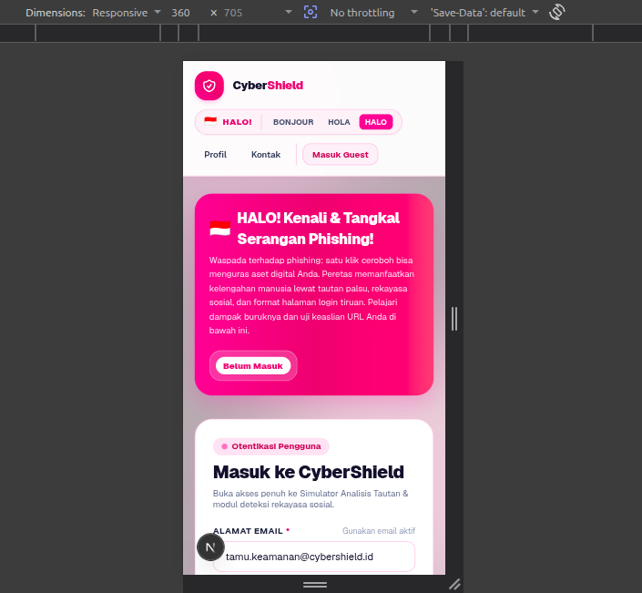
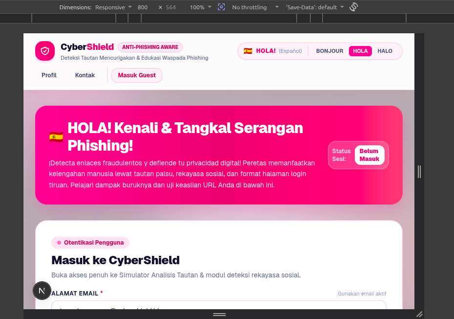
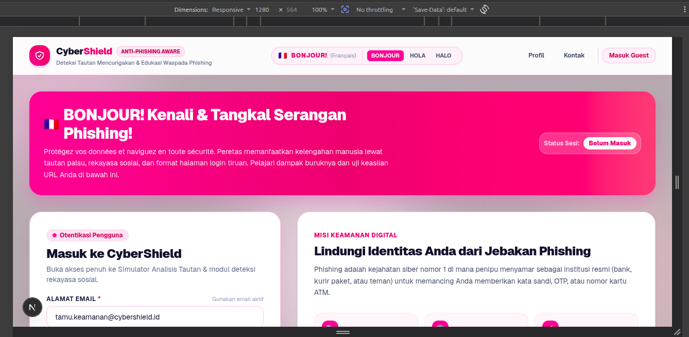

# Dokumentasi Praktikum Web — Modul 2

## Identitas

Nama : Silviana Maristha Ginting (105224001)
---

# 1. Struktur Semantik

## 1.1 Gambaran Umum

Website yang dibuat merupakan aplikasi **CyberShield**, yaitu halaman edukasi dan simulasi untuk membantu pengguna mengenali tautan phishing. Struktur halaman disusun menggunakan elemen HTML semantik agar bagian-bagian halaman memiliki fungsi yang jelas, baik untuk pengguna biasa maupun teknologi bantu seperti screen reader.

Struktur utama halaman terdiri dari:

```text
<body>
└── <header>
    ├── Identitas/branding CyberShield
    ├── Informasi status
    └── Navigasi
└── <main>
    ├── Section hero
    ├── Section login/autentikasi
    ├── Section simulator detektor URL
    └── Section perbandingan dampak phishing
└── <footer>
    ├── Informasi CyberShield
    └── Tombol aksi
```

Pada implementasinya, halaman utama menggunakan:

- `<header role="banner">`
- `<nav role="navigation">`
- `<main role="main">`
- `<section role="region">`
- `<footer role="contentinfo">`

Penggunaan struktur tersebut membantu memberikan batas yang jelas antara area navigasi, konten utama, dan informasi tambahan.

## 1.2 Header dan Navigasi

Bagian header berisi identitas CyberShield, status keamanan, sapaan multibahasa, serta navigasi.

Contoh struktur yang digunakan:

```tsx
<header role="banner">
  ...
  <nav
    role="navigation"
    aria-label="Navigasi Utama CyberShield"
  >
    ...
  </nav>
</header>
```

Navigasi diberi nama menggunakan `aria-label` sehingga pengguna screen reader dapat mengetahui fungsi navigasi tersebut.

Di dalam navigasi terdapat tombol seperti:

- Profil
- Kontak
- Masuk/Guest

Tombol digunakan karena aksinya mengubah state atau membuka dialog, bukan berpindah ke URL lain.

## 1.3 Main Content

Konten utama dibungkus menggunakan elemen `<main>`:

```tsx
<main
  role="main"
  className="flex-1 max-w-7xl w-full mx-auto ..."
>
  ...
</main>
```

Di dalamnya terdapat beberapa section utama.

### A. Hero

Hero memperkenalkan tujuan website dengan judul:

> HALO! Kenali & Tangkal Serangan Phishing!

Section memiliki hubungan dengan heading menggunakan `aria-labelledby`.

```tsx
<section
  role="region"
  aria-labelledby="hero-banner-heading"
>
```

### B. Login / Autentikasi

Section login memiliki heading:

> Masuk ke CyberShield

Form login menyediakan:

- Alamat Email
- Kata Sandi
- Ingat Saya
- Tombol Masuk
- Akses mode tamu

Input menggunakan `<label>` yang terhubung dengan input melalui `htmlFor` dan `id`.

Contoh:

```tsx
<label htmlFor={emailInputId}>
  Alamat Email
</label>

<input id={emailInputId} ... />
```

Cara ini membuat hubungan antara label dan kontrol form dapat dikenali oleh browser dan teknologi bantu.

### C. Simulator & Detektor Tautan Phishing

Bagian ini digunakan untuk memasukkan URL dan menjalankan simulasi analisis.

Heading:

> Simulator & Detektor Tautan Phishing

Input URL memiliki label:

```tsx
<label htmlFor={urlInputId}>
  Alamat Tautan (URL) yang Ingin Dianalisis
</label>
```

Hasil analisis dapat menampilkan informasi mengenai:

- HTTPS
- Domain mencurigakan
- Kata kunci
- Ekstensi file
- Rekomendasi keamanan

### D. Perbandingan Waspada dan Tidak Waspada

Section ini membandingkan dampak ketika pengguna:

1. Waspada terhadap phishing.
2. Mengabaikan tanda-tanda phishing.

Konten dibagi menjadi dua area agar informasi lebih mudah dibandingkan.

## 1.4 Footer

Footer menggunakan:

```tsx
<footer role="contentinfo">
```

Footer berisi informasi mengenai CyberShield dan beberapa aksi seperti:

- Tentang CyberShield
- Laporkan URL Penipuan

Tombol digunakan karena masing-masing aksi membuka dialog.

## 1.5 Dialog

Website memiliki dialog untuk:

- Profil pengguna dan status keamanan.
- Kontak tim CyberShield dan pelaporan tautan.

Contoh:

```tsx
<div
  role="dialog"
  aria-modal="true"
  aria-labelledby="profile-dialog-title"
>
```

Dialog diberi:

- `role="dialog"` untuk menyatakan bahwa elemen merupakan dialog.
- `aria-modal="true"` untuk menyatakan bahwa dialog bersifat modal.
- `aria-labelledby` untuk menghubungkan dialog dengan judulnya.

Tombol penutup juga memiliki accessible name, misalnya:

```tsx
aria-label="Tutup jendela profil"
```

---

# 2. Tata Letak Responsif

## 2.1 Konsep

Website dibuat agar dapat digunakan pada berbagai ukuran layar. Implementasi menggunakan **Tailwind CSS** dengan responsive breakpoint seperti:

- ukuran dasar/mobile
- `sm:`
- `md:`
- `lg:`

Beberapa class yang digunakan pada halaman menggunakan pola seperti:

```tsx
text-xl sm:text-2xl md:text-3xl
```

dan:

```tsx
px-4 sm:px-6 lg:px-8
```

Dengan pendekatan tersebut, ukuran teks, padding, dan lebar konten dapat menyesuaikan ukuran layar.

## 2.2 Pengujian Ukuran Layar

Pengujian dilakukan pada tiga ukuran tampilan yang didokumentasikan dalam folder `docs/praktikum`.

### A. Tampilan 360 px



Pada ukuran mobile, elemen halaman disusun secara vertikal sehingga konten tetap dapat dibaca tanpa harus menggunakan layout desktop.

Bagian yang terlihat antara lain:

- Branding CyberShield.
- Sapaan utama.
- Deskripsi mengenai phishing.
- Bagian login CyberShield.

Tampilan menyesuaikan ruang layar yang lebih sempit dengan mengubah ukuran teks dan spacing.

### B. Tampilan 800 px



Pada ukuran menengah, halaman mulai memiliki ruang horizontal yang lebih besar. Navigasi dan konten dapat ditampilkan dengan ruang yang lebih lega dibandingkan ukuran 360 px.

Elemen utama tetap dapat diakses tanpa mengubah fungsi halaman.

### C. Tampilan 1280 px



Pada ukuran desktop, layout dapat memanfaatkan ruang horizontal yang lebih luas.

Konten seperti navigasi, informasi login, dan edukasi phishing dapat ditampilkan dengan lebih leluasa.

## 2.3 Kesimpulan Pengujian Responsif

Berdasarkan dokumentasi tampilan 360 px, 800 px, dan 1280 px, website menggunakan pendekatan responsive design sehingga layout tidak hanya ditujukan untuk satu ukuran layar.

Perubahan terutama dilakukan pada:

- ukuran typography,
- padding dan spacing,
- lebar container,
- susunan konten,
- dan distribusi ruang pada area utama.

---

# 3. Audit Aksesibilitas

## 3.1 Tujuan Audit

Audit aksesibilitas dilakukan untuk mengetahui apakah halaman dapat digunakan oleh pengguna dengan berbagai kebutuhan akses, termasuk pengguna yang menggunakan keyboard atau teknologi bantu.

Audit dilakukan menggunakan **Lighthouse pada Google Chrome**.

Firefox digunakan untuk melihat **Accessibility Tree/Accessibility Inspector**, karena Firefox menyediakan tampilan struktur aksesibilitas yang membantu melihat bagaimana browser mengenali elemen halaman.

## 3.2 Audit Halaman Utama

Audit halaman utama dilakukan pada:

```text
http://localhost:3000/
```

Hasil audit yang terdokumentasi menunjukkan skor:

**Accessibility: 96**


Audit menunjukkan masih terdapat satu temuan terkait **contrast**, yaitu:

> Background and foreground colors do not have a sufficient contrast ratio.

Selain temuan otomatis tersebut, Lighthouse juga menampilkan bagian **Additional Items to Manually Check**. Bagian tersebut menunjukkan bahwa pemeriksaan otomatis tidak mencakup seluruh aspek aksesibilitas sehingga pengujian manual tetap diperlukan.

## 3.3 Audit Halaman Latihan

Halaman khusus latihan audit tersedia pada:

```text
http://localhost:3000/latihan-audit
```

Halaman ini digunakan untuk latihan menemukan masalah aksesibilitas.

Hasil Lighthouse yang terdokumentasi menunjukkan:

**Accessibility: 85**


Pada audit tersebut ditemukan masalah:

> Buttons do not have an accessible name.

Masalah tersebut menunjukkan bahwa terdapat tombol yang secara visual dapat digunakan, tetapi informasi yang diperlukan teknologi bantu untuk mengetahui nama/fungsi tombol belum tersedia dengan baik.

Selain itu, audit juga menemukan:

> Background and foreground colors do not have a sufficient contrast ratio.

Artinya, terdapat kombinasi warna teks dan latar belakang yang memiliki rasio kontras di bawah tingkat yang direkomendasikan oleh pemeriksaan Lighthouse.

## 3.4 Perbandingan Hasil Audit

| Halaman | Accessibility | Temuan utama |
|---|---:|---|
| `/` | 96 | Kontras warna |
| `/latihan-audit` | 85 | Accessible name pada tombol dan kontras warna |

Halaman `/latihan-audit` sengaja digunakan sebagai halaman latihan agar masalah aksesibilitas dapat diamati melalui Lighthouse.

## 3.5 Accessibility Tree


Accessibility Tree digunakan untuk melihat bagaimana browser memetakan struktur halaman ke dalam informasi yang dapat dipahami teknologi bantu.

Pada hasil pemeriksaan terlihat beberapa informasi penting seperti:

- `banner`
- `navigation`
- `main`
- `region`
- `button`
- `heading`
- `paragraph`
- `StaticText`

Contoh yang terlihat pada Accessibility Tree:

```text
banner
navigation "Navigasi Utama CyberShield"
main
region "BONJOUR! Kenali & Tangkal Serangan Phishing!"
region "Masuk ke CyberShield"
heading "Masuk ke CyberShield"
```

Struktur tersebut menunjukkan bahwa elemen semantik pada halaman dikenali oleh browser sebagai struktur aksesibilitas, bukan hanya sebagai tampilan visual.

---

# 4. Pengujian Keyboard

## 4.1 Tujuan

Pengujian keyboard dilakukan untuk memastikan pengguna dapat menjalankan fungsi utama website tanpa harus menggunakan mouse.

Pengujian dilakukan menggunakan keyboard secara langsung.

## 4.2 Skenario Pengujian

Beberapa tombol yang digunakan:

| Input | Fungsi |
|---|---|
| `Tab` | Berpindah ke elemen interaktif berikutnya |
| `Shift + Tab` | Kembali ke elemen interaktif sebelumnya |
| `Space` | Mengaktifkan kontrol tertentu seperti radio/button |
| `Enter` | Mengaktifkan tombol yang sedang fokus |

## 4.3 Hasil Pengujian

Hasil pengujian keyboard dinyatakan **aman**.

Hal-hal yang diperiksa:

- Elemen interaktif dapat dicapai menggunakan `Tab`.
- `Shift + Tab` dapat digunakan untuk kembali ke elemen sebelumnya.
- Tombol dapat diaktifkan menggunakan `Enter`.
- Kontrol tertentu dapat dioperasikan menggunakan `Space`.
- Urutan fokus mengikuti alur halaman.
- Fokus masih terlihat ketika berpindah menggunakan keyboard.

Dengan demikian, fungsi utama halaman dapat digunakan tanpa bergantung sepenuhnya pada mouse.

---

# 5. Latihan Audit

## 5.1 Tujuan

Halaman `/latihan-audit` dibuat sebagai media latihan untuk mengidentifikasi masalah aksesibilitas menggunakan Lighthouse.

Berbeda dengan halaman utama, halaman latihan digunakan untuk memperlihatkan bagaimana kesalahan implementasi aksesibilitas dapat menghasilkan temuan audit.

URL:

```text
http://localhost:3000/latihan-audit
```

## 5.2 Masalah yang Ditemukan

Berdasarkan hasil Lighthouse, masalah yang terlihat adalah:

### 1. Button tidak memiliki accessible name

Lighthouse melaporkan:

```text
Buttons do not have an accessible name
```

Accessible name diperlukan agar teknologi bantu dapat menjelaskan fungsi sebuah tombol kepada pengguna.

### 2. Kontras warna

Lighthouse juga melaporkan:

```text
Background and foreground colors do not have a sufficient contrast ratio
```

Masalah ini berkaitan dengan keterbacaan antara warna foreground dan background.

## 5.3 Perbandingan dengan Halaman Utama

Halaman utama memiliki struktur aksesibilitas yang lebih baik dan memperoleh skor 96, sedangkan halaman latihan memiliki beberapa masalah yang sengaja digunakan sebagai bahan audit dan memperoleh skor 85.

Latihan ini membantu memahami bahwa tampilan visual yang terlihat baik belum tentu berarti halaman sudah sepenuhnya aksesibel.

---

# 6. Pemanfaatan AI

## 6.1 Antigravity

**Antigravity** digunakan sebagai alat bantu utama dalam proses pembuatan website.

Antigravity digunakan untuk membantu:

- membuat struktur halaman,
- membuat komponen React,
- menulis kode TypeScript,
- menyusun styling dengan Tailwind CSS,
- membuat fitur interaksi,
- dan melakukan pengembangan halaman CyberShield.

Dalam proses tersebut digunakan Antigravity.

AI digunakan sebagai alat bantu pengembangan, sedangkan hasil implementasi tetap diperiksa dan diuji melalui browser.

## 6.2 ChatGPT

**ChatGPT** digunakan untuk:

- membantu memahami isi dan instruksi Modul 2,
- menjelaskan konsep yang diperlukan dalam pengerjaan,
- membantu memahami hasil audit,
- membantu menyusun dokumen teknis,
- dan merapikan dokumentasi hasil praktikum dalam format Markdown.

ChatGPT tidak digunakan sebagai pengganti pengujian. Hasil website tetap diperiksa melalui browser, Lighthouse, Accessibility Tree, serta pengujian keyboard.

## 6.3 Alur Pemanfaatan AI

Alur penggunaan AI dalam pengerjaan dapat diringkas sebagai berikut:

```text
Instruksi Modul 2
       ↓
Memahami kebutuhan tugas
       ↓
Antigravity
       ↓
Pengembangan website CyberShield
       ↓
Pengujian browser
       ↓
Lighthouse + Accessibility Tree
       ↓
Pengujian keyboard
       ↓
ChatGPT
       ↓
Pemahaman hasil + penyusunan dokumentasi
```

---

# 7. Kendala dan Penyelesaian

Selama pengerjaan modul ini **tidak terdapat kendala yang berarti**.

Proses pengembangan, pengujian responsive layout, audit aksesibilitas, pemeriksaan Accessibility Tree, pengujian keyboard, dan penyusunan dokumentasi dapat dilakukan sesuai kebutuhan praktikum.

Dengan demikian, tidak terdapat bagian troubleshooting khusus yang perlu dicantumkan.

---

