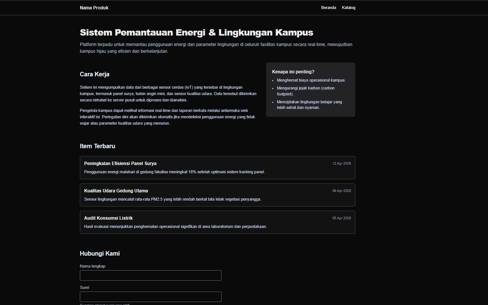
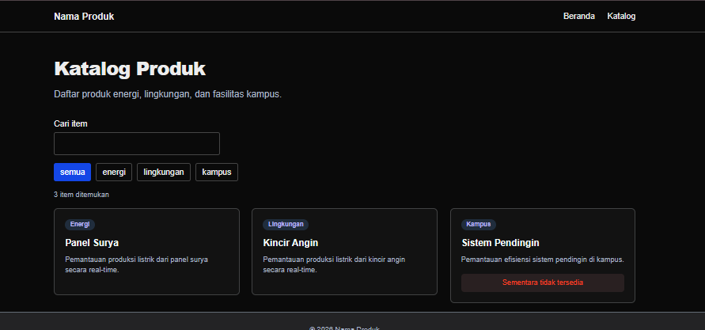

# Dokumen Teknis Modul 3 --- TypeScript dan Komponen React

**Nama:** Silviana Maristha Ginting\
**NIM:** 105224001\
**Repositori:** `https://github.com/silvi1206/Pemweb-Silvi`

## 1. Tipe Data Produk

Tipe data produk didefinisikan pada `lib/tipe.ts` menggunakan
`union type` untuk kategori dan `interface` untuk struktur data item.

``` ts
export type Kategori = "energi" | "lingkungan" | "kampus";

export interface Item {
  id: string;
  judul: string;
  kategori: Kategori;
  deskripsi: string;
  tersedia?: boolean;
}
```

`union type` digunakan pada `Kategori` agar nilai kategori hanya dapat
berupa `"energi"`, `"lingkungan"`, atau `"kampus"`. Properti `tersedia`
dibuat opsional karena tidak semua item harus memiliki nilai tersebut.

## 2. Struktur Komponen

Struktur komponen utama pada aplikasi:

``` text
Halaman Beranda
├── SiteHeader
├── Bagian
│   └── Konten Beranda
├── ItemTerbaru
│   └── Data dari /data/item.json
└── SiteFooter

Halaman Katalog
├── SiteHeader
├── HalamanKatalog
│   └── DaftarItem
│       └── KartuItem
└── SiteFooter
```

`DaftarItem` merupakan **Client Component** karena menggunakan
`useState` untuk menyimpan kata kunci pencarian dan filter kategori.
`ItemTerbaru` juga merupakan **Client Component** karena menggunakan
`useEffect`, `useState`, dan `fetch()` untuk mengambil data dari
`item.json`.

  -----------------------------------------------------------------------
  Komponen                            Peran
  ----------------------------------- -----------------------------------
  `HalamanKatalog`                    Menampilkan halaman katalog dan
                                      meneruskan data item ke
                                      `DaftarItem`

  `DaftarItem`                        Mengelola pencarian, filter
                                      kategori, dan daftar item

  `KartuItem`                         Menampilkan informasi setiap item

  `ItemTerbaru`                       Mengambil dan menampilkan tiga item
                                      terbaru dari `item.json`

  `Bagian`                            Komponen pembungkus bagian konten
                                      dengan judul

  `SiteHeader`                        Menampilkan navigasi halaman

  `SiteFooter`                        Menampilkan bagian footer
  -----------------------------------------------------------------------

## 3. State dan Interaksi

Komponen `DaftarItem` memiliki dua state utama:

-   `kataKunci` untuk menyimpan kata kunci pencarian.
-   `filter` untuk menyimpan kategori yang dipilih.

State diperbarui melalui event pada input pencarian dan tombol filter.
Ketika state berubah, React melakukan **re-render** sehingga daftar item
yang ditampilkan menyesuaikan hasil pencarian atau kategori.

### Bukti React DevTools


Pada React DevTools terlihat:

-   Props `items` diterima oleh `DaftarItem`.
-   State pertama bernilai `""` untuk `kataKunci`.
-   State kedua bernilai `"semua"` untuk `filter`.
-   Komponen dirender oleh `HalamanKatalog`.
-   Source komponen menunjukkan `DaftarItem.tsx:9`.

## 4. Pengambilan Data

Komponen `ItemTerbaru` mengambil data menggunakan:

``` ts
fetch("/data/item.json")
```

Data JSON kemudian diproses menggunakan `response.json()` dan tiga item
pertama ditampilkan.

Pengambilan data dapat diverifikasi melalui **DevTools → Network**.

### Bukti Network


Request menunjukkan:

-   Request URL: `http://localhost:3000/data/item.json`
-   Request Method: `GET`
-   Status Code: `200 OK`
-   Content-Type: `application/json`

Hal ini menunjukkan bahwa file `item.json` berhasil diminta oleh
aplikasi.

## 5. Verifikasi

### 5.1 Pemeriksaan TypeScript

Perintah yang digunakan:

``` bash
npx tsc --noEmit
```

Hasil pemeriksaan tidak menunjukkan error TypeScript.


### 5.2 Pemeriksaan ESLint

Perintah yang digunakan:

``` bash
npm run lint
```

Hasil:

``` text
1 problem (0 errors, 1 warning)
```

Warning berasal dari `SiteFooter.tsx` karena `SiteFooterProps`
didefinisikan tetapi belum digunakan. Tidak terdapat error ESLint.


## 6. Bukti Tampilan Aplikasi

### 6.1 Halaman Beranda



Halaman Beranda menampilkan informasi sistem, bagian cara kerja, alasan
pentingnya sistem, item terbaru, dan formulir kontak.

### 6.2 Halaman Katalog



Halaman Katalog menampilkan tiga item dengan kategori energi,
lingkungan, dan kampus. Tersedia juga fitur pencarian serta filter
berdasarkan kategori.

## 7. Kendala dan Penyelesaian

**Kendala:** Pada awal implementasi, pengambilan data dari `item.json`
belum terlihat pada Network karena komponen yang melakukan `fetch()`
belum digunakan pada halaman. Selain itu, browser sempat menampilkan
status `304 Not Modified` karena data tersimpan dalam cache.

**Penyelesaian:** Komponen `ItemTerbaru` digunakan pada halaman sehingga
request `item.json` dapat diamati melalui DevTools Network. Cache
browser dinonaktifkan saat pengujian sehingga request menghasilkan
status `200 OK`. Pada proses verifikasi, TypeScript berhasil dijalankan
tanpa error, sedangkan ESLint menghasilkan 0 error dan 1 warning dari
deklarasi `SiteFooterProps` yang belum digunakan.

## 8. Catatan Pemanfaatan AI

AI dimanfaatkan sebagai alat bantu dalam memahami materi TypeScript dan
React, khususnya penggunaan tipe data, props, state, event, `useEffect`,
dan pengambilan data menggunakan `fetch()`. AI juga digunakan untuk
membantu menganalisis error dan memberikan arahan dalam proses debugging
serta penyusunan dokumentasi praktikum. Implementasi kode, pengujian,
dan verifikasi akhir dilakukan pada project secara langsung.
