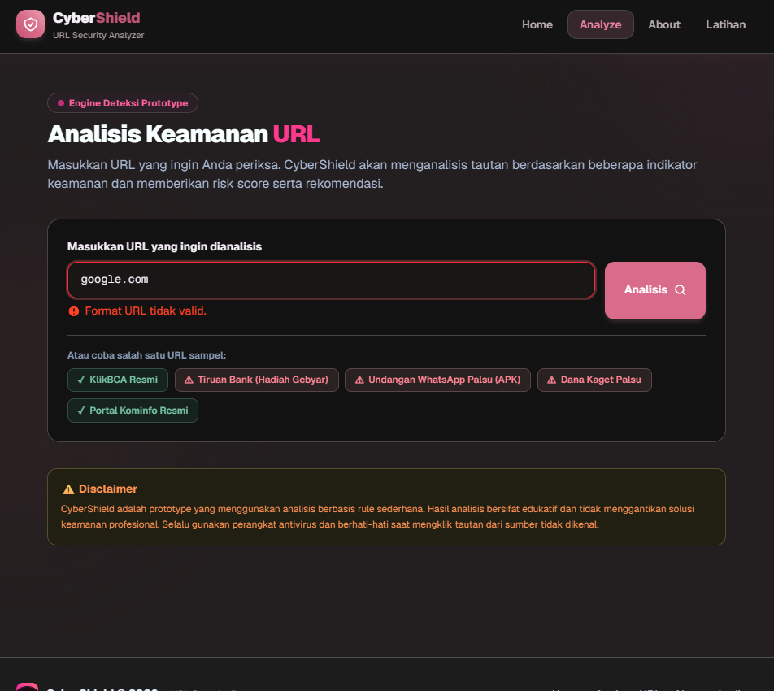

# Dokumen Teknis Modul 5 — Formulir, Validasi, Session, dan Cookie

Nama/NIM : Silviana Maristha Ginting / 105224001  
Repositori : https://github.com/silvi1206/Pemweb-Silvi.git

---

## 1. Skema Validasi

### Tabel Kolom Formulir: Nama Kolom, Aturan Zod, Pesan Galat

Pada implementasi Modul 5, validasi skema dibangun menggunakan pustaka **Zod versi 4** (`zod@^4.6.7`). Skema didefinisikan secara terpusat pada berkas [`lib/skema.ts`](file:///d:/webprak/week5/lib/skema.ts) dan menjadi sumber kebenaran tunggal (*single source of truth*) untuk validasi bentuk data di sisi server sekaligus penyedia tipe statis TypeScript melalui `z.infer`.

Berikut adalah rincian aturan validasi formulir utama penambahan item katalog (`skemaItem`):

| Nama Kolom | Tipe Data & Input | Aturan Zod 4 | Pesan Galat |
|---|---|---|---|
| `judul` | `string` (Input Text) | `z.string().trim().min(3, ...).max(80, ...)` | Min: "Judul minimal 3 karakter"<br>Max: "Judul maksimal 80 karakter" |
| `kategori` | `enum` (Select Option) | `z.enum(["energi", "lingkungan", "kampus"], { error: ... })` | "Pilih salah satu kategori" |
| `deskripsi` | `string` (Textarea) | `z.string().trim().min(10, ...).max(300, ...)` | Min: "Deskripsi minimal 10 karakter"<br>Max: "Deskripsi maksimal 300 karakter" |
| `tersedia` | `boolean` (Checkbox) | `z.stringbool().default(false)` | Nilai bawaan `false` bila tidak dicentang (konversi "on"/"off" otomatis) |

Selain formulir item katalog, terdapat pula formulir autentikasi masuk pengelola (`skemaMasuk`):

| Nama Kolom | Tipe Data & Input | Aturan Zod 4 | Pesan Galat |
|---|---|---|---|
| `email` | `string` (Input Email) | `z.email("Format email tidak valid")` | "Format email tidak valid" |
| `kataSandi` | `string` (Input Password) | `z.string().min(8, "Kata sandi minimal 8 karakter")` | "Kata sandi minimal 8 karakter" |

Sebagai pelengkap arsitektur produk CyberShield (*URL Security Analyzer*), skema validasi masukan URL pada [`lib/validation.ts`](file:///d:/webprak/week5/lib/validation.ts) juga menggunakan pola Zod 4:

| Nama Kolom | Tipe Data & Input | Aturan Zod 4 | Pesan Galat |
|---|---|---|---|
| `url` | `string` (Input URL) | `z.string().trim().min(1, ...).url("Format URL tidak valid.").refine(...)` | "Format URL tidak valid." / "URL harus diawali dengan http:// atau https://" |

#### Penerapan API Spesifik Zod 4
Pada Zod 4, terdapat sejumlah modernisasi API penting yang diimplementasikan:
1. **Pemformatan Galat Lapangan**: Menggunakan fungsi tingkat atas `z.flattenError(error).fieldErrors` untuk menghasilkan peta pesan galat per kolom bertipe `Record<string, string[] | undefined>`.
2. **Format Email Tingkat Atas**: Menggunakan fungsi validator langsung `z.email("Format email tidak valid")`.
3. **Konversi Checkbox**: Menggunakan `z.stringbool().default(false)` untuk mengubah nilai `FormData` bawaan checkbox peramban (`"on"` atau ketiadaan kunci) menjadi tipe murni `boolean`.
4. **Pembersihan Payload**: Menggunakan `z.object({...})` yang otomatis membuang kunci tambahan tak dikenal yang dikirim oleh penyerang (*over-posting protection*).

---

### Aturan Semantik yang Diperiksa di Server Action dan Alasannya

Validasi perangkat lunak dibagi menjadi dua tingkatan:
1. **Validasi Bentuk (Sintaksis)**: Memeriksa struktur, tipe data, panjang teks, serta kesesuaian format masukan. Dilakukan secara deklaratif menggunakan `skemaItem.safeParse(mentah)` tanpa melibatkan pembacaan basis data atau memori status aplikasi.
2. **Validasi Semantik (Logika Bisnis & Status Tersimpan)**: Memeriksa keabsahan makna data berdasarkan konteks operasional dan data yang sudah ada di sistem.

**Aturan semantik yang diterapkan**:
Pemeriksaan keunikan judul item melalui fungsi `judulSudahAda(hasil.data.judul)` pada [`lib/data.ts`](file:///d:/webprak/week5/lib/data.ts). Aturan ini menolak penyimpanan item baru jika judul yang dimasukkan sudah digunakan oleh item lain (pencarian dilakukan secara *case-insensitive*).

**Alasan diperiksa di Server Action (bukan di dalam Skema Zod)**:
- **Keterpisahan Tanggung Jawab (*Separation of Concerns*)**: Skema Zod dirancang murni untuk mengevaluasi bentuk data masukan (*input shape validation*). Menyematkan logika *query* atau status tersimpan ke dalam skema akan membuat skema bergantung pada *state* luar, sulit diuji (*mocking*), dan tidak dapat dibagikan dengan aman ke modul lain.
- **Efisiensi Beban Komputasi**: Validasi semantik melibatkan pencarian pada penyimpanan data. Dengan menjalankan `skemaItem.safeParse()` terlebih dahulu, sistem memastikan bahwa *query* semantik hanya dijalankan jika data masukan terbukti valid secara bentuk. Masukan yang cacat langsung ditolak di langkah awal tanpa membebani sistem penyimpanan.

---

## 2. Alur Server Action

### Urutan Pemeriksaan di Dalam Server Action

Server Action [`simpanItem`](file:///d:/webprak/week5/app/katalog/actions.ts) menerapkan urutan pemeriksaan defensif 5 langkah yang ketat untuk menjamin keamanan dan integritas data:

```
[1. Pemeriksaan Sesi]
      │
      ├── (Gagal) ──> Kembalikan { pesan: "Silakan masuk terlebih dahulu." }
      ▼ (Sah)
[2. Validasi Bentuk (Zod 4 safeParse)]
      │
      ├── (Gagal) ──> Kembalikan galat per kolom dari z.flattenError + nilai isian
      ▼ (Sah)
[3. Validasi Semantik (judulSudahAda)]
      │
      ├── (Gagal) ──> Kembalikan { galat: { judul: ["Judul sudah dipakai item lain"] } }
      ▼ (Sah)
[4. Mutasi Data (tambahItem di dalam try..catch)]
      │
      ├── (Error) ──> Log detail error di server; kembalikan pesan umum ramah
      ▼ (Sukses)
[5. Revalidasi & Pengalihan Rute (di luar try..catch)]
      │
      └──> revalidatePath("/katalog") lalu redirect(`/katalog/${id}`)
```

1. **Pemeriksaan Sesi (`bacaSesi()`):**
   Memeriksa apakah permintaan dikirim oleh pengguna yang telah terautentikasi melalui cookie sesi valid. Jika sesi tidak ada atau kedaluwarsa, Server Action langsung menghentikan proses dan mengembalikan pesan status `"Silakan masuk terlebih dahulu."`. Masukan tidak diproses lebih jauh.
2. **Validasi Bentuk Data (`skemaItem.safeParse(mentah)`):**
   Mengekstrak `FormData` dan memvalidasi struktur data dengan skema Zod. Jika terjadi kesalahan input (misalnya teks terlalu pendek atau kategori kosong), fungsi langsung mengembalikan pesan galat per kolom menggunakan `z.flattenError(hasil.error).fieldErrors` bersama objek `nilai` agar formulir tidak ter-reset kosong.
3. **Validasi Semantik (`judulSudahAda(hasil.data.judul)`):**
   Memeriksa integritas bisnis apakah judul item sudah terdaftar pada memori sistem. Jika ditemukan duplikasi, sistem mengembalikan galat spesifik pada kolom `judul`.
4. **Mutasi Data (`tambahItem(hasil.data)`):**
   Menyimpan data item baru ke dalam memori aplikasi di dalam blok `try...catch`. Bila terjadi galat tak terduga pada layer penyimpanan, detail exception dicatat secara aman pada log server melalui `console.error()`, dan pengguna menerima pesan umum `"Item gagal disimpan. Coba lagi."` tanpa membocorkan rincian *stack trace* internal.
5. **Revalidasi dan Pengalihan Rute (`revalidatePath` lalu `redirect`):**
   Setelah mutasi sukses, `revalidatePath("/katalog")` menandai bahwa *cache* halaman daftar katalog perlu diperbarui, kemudian `redirect('/katalog/${id}')` memindahkan pengguna ke halaman rincian item baru.

> [!IMPORTANT]
> **Penempatan `redirect()` di Luar Blok `try...catch`**:
> Fungsi `redirect()` pada Next.js bekerja secara internal dengan melempar *special exception* bertipe `NEXT_REDIRECT`. Jika panggilan `redirect()` diletakkan di dalam blok `try`, blok `catch` akan menangkap exception ini dan menganggapnya sebagai error mutasi biasa. Akibatnya, alur pengalihan URL akan dibatalkan dan pengguna tidak pernah berpindah halaman. Oleh karena itu, pemanggilan `redirect()` wajib diletakkan di luar blok `try`.

---

### Pembagian Berkas: Server Component, Client Component, dan Berkas "use server"

Arsitektur aplikasi memisahkan komponen antarmuka, *boundary* eksekusi, dan pustaka logika secara disiplin:

1. **Server Component (`app/katalog/tambah/page.tsx`, `app/katalog/page.tsx`, `app/masuk/page.tsx`):**
   - Merupakan komponen default pada Next.js App Router yang dieksekusi secara eksklusif di server.
   - Bertanggung jawab melakukan pemeriksaan sesi awal secara asynchronous (`await bacaSesi()`) sebelum merender antarmuka. Bila sesi tidak ditemukan, Server Component dapat memicu `redirect("/masuk")` bahkan sebelum HTML mulai dikirim ke browser.
   - Tidak menambah ukuran bundel JavaScript di sisi klien (*zero client-side bundle size*).
2. **Client Component (`components/FormItem.tsx`, `components/FormMasuk.tsx`):**
   - Ditandai dengan direktif `"use client"` di baris teratas.
   - Menggunakan hook React 19 `useActionState` untuk mengikat Server Action ke elemen `<form>`, menangkap status pengiriman (`pending`), serta menampilkan pesan status dan galat per kolom secara reaktif.
   - Mengimplementasikan standar aksesibilitas interaktif dengan atribut `aria-invalid` dan `aria-describedby` yang dinamis sesuai status kesalahan.
   - Menerapkan mekanisme retensi nilai formulir menggunakan atribut `key` dan `defaultValue` sehingga data yang diketikkan pengguna tidak hilang saat validasi gagal.
3. **Berkas "use server" (`app/katalog/actions.ts`, `app/masuk/actions.ts`):**
   - Ditandai dengan direktif `"use server"` pada awal berkas.
   - Menghasilkan fungsi async yang dipublikasikan oleh Next.js sebagai endpoint *Remote Procedure Call* (RPC) berbasis POST yang aman dan terlindungi dari manipulasi langsung.
   - Menjaga kerahasiaan logika bisnis, variabel lingkungan rahasia, dan operasi mutasi data agar tidak pernah terekspos ke bundel klien.
4. **Boundary Keamanan Eksplisit (`lib/sesi.ts`):**
   - Dilengkapi modul pengaman `import "server-only";`.
   - Menjamin bila ada pengembang yang tidak sengaja mengimpor modul sesi atau fungsi manipulasi cookie ke dalam Client Component, proses kompilasi `npm run build` akan langsung gagal (*fail-closed*).

---

## 3. Bukti Uji Validasi

### Tabel Kasus Uji Validasi

Pengujian formulir item dan sistem validasi dilakukan secara menyeluruh dengan 9 kasus uji terstruktur, mencakup pengujian masukan sah, pengujian batas panjang data, pengujian pemulihan nilai input, serta pengujian *client-side bypass*:

| No | Skenario Uji | Data Masukan (Judul, Kategori, Deskripsi, Tersedia) | Hasil yang Diharapkan | Hasil Nyata | Status |
|---|---|---|---|---|---|
| 1 | Pengiriman data sah lengkap | Judul: `"Sensor Kualitas Air Cerdas"`<br>Kategori: `"lingkungan"`<br>Deskripsi: `"Sensor pemantau pH dan kekeruhan air danau kampus secara daring."`<br>Tersedia: `true` | Data tersimpan, redirect ke `/katalog/[id]`, item muncul di katalog. | Pengguna berhasil dialihkan ke `/katalog/4`, detail item baru tampil utuh. | **LOLOS** |
| 2 | Judul terlalu pendek (< 3 karakter) | Judul: `"AB"`<br>Kategori: `"energi"`<br>Deskripsi: `"Deskripsi alat pemantau konsumsi listrik gedung."`<br>Tersedia: `true` | Ditolak; galat pada kolom judul: `"Judul minimal 3 karakter"`. Isian form bertahan. | Muncul galat di bawah kolom judul; input judul ditandai `aria-invalid="true"`. | **LOLOS** |
| 3 | Judul melebihi batas (> 80 karakter) | Judul: `"Pengukur Daya Listrik Arus Searah dan Bolak-Balik Terintegrasi dengan Sistem Otomatisasi Gedung Kampus"` (94 char)<br>Kategori: `"energi"`<br>Deskripsi: `"Deskripsi alat yang cukup panjang untuk pengujian."`<br>Tersedia: `true` | Ditolak; galat pada kolom judul: `"Judul maksimal 80 karakter"`. | Galat panjang judul tertangkap dan pesan spesifik tampil di bawah input judul. | **LOLOS** |
| 4 | Kategori tidak dipilih | Judul: `"Monitor Daya Panel"`<br>Kategori: `""` (tidak dipilih)<br>Deskripsi: `"Perangkat monitoring daya surya berskala kecil."`<br>Tersedia: `false` | Ditolak; galat pada kolom kategori: `"Pilih salah satu kategori"`. | Tampil galat `"Pilih salah satu kategori"`, nilai judul dan deskripsi tetap ada. | **LOLOS** |
| 5 | Deskripsi terlalu pendek (< 10 karakter) | Judul: `"Sistem Lampu Pintar"`<br>Kategori: `"kampus"`<br>Deskripsi: `"Pendek"` (6 char)<br>Tersedia: `true` | Ditolak; galat pada kolom deskripsi: `"Deskripsi minimal 10 karakter"`. | Galat deskripsi tampil di bawah textarea; nilai judul dan kategori bertahan. | **LOLOS** |
| 6 | Validasi Semantik: Judul duplikat | Judul: `"Pengukur Daya Listrik Surya"` (sudah ada)<br>Kategori: `"energi"`<br>Deskripsi: `"Mencoba menambahkan alat yang sama dengan deskripsi berbeda."`<br>Tersedia: `true` | Ditolak; galat semantik: `"Judul sudah dipakai item lain"`. | Validasi bentuk lolos, Server Action menolak mutasi dan menampilkan galat judul ganda. | **LOLOS** |
| 7 | **Bypass Klien 1 (novalidate)**: Judul terlalu pendek | Atribut `novalidate` dipasang di `<form>`.<br>Judul: `"ab"`<br>Kategori: `"energi"`<br>Deskripsi: `"Alat deteksi kebocoran arus listrik tersembunyi."`<br>Tersedia: `true` | Validasi HTML klien dilewati; ditolak di server dengan galat `"Judul minimal 3 karakter"`. | Server Action menangkap masukan cacat dan mengembalikan galat ke antarmuka. | **LOLOS** |
| 8 | **Bypass Klien 2 (novalidate)**: Kategori kosong | Atribut `novalidate` dipasang di `<form>`.<br>Judul: `"Kamera Pemantau Ruang"`<br>Kategori: `""`<br>Deskripsi: `"Kamera pemantau hemat energi untuk fasilitas gedung perkuliahan."`<br>Tersedia: `false` | Validasi HTML `required` dilewati; server menolak dengan galat `"Pilih salah satu kategori"`. | Galat Zod 4 `z.enum` berhasil ditampilkan di bawah kolom kategori. | **LOLOS** |
| 9 | **Bypass Klien 3 (novalidate)**: Deskripsi > 300 karakter | Atribut `novalidate` dipasang di `<form>`.<br>Judul: `"Stasiun Pemantau Cuaca"`<br>Kategori: `"lingkungan"`<br>Deskripsi: Teks sepanjang 400 karakter acak.<br>Tersedia: `true` | Batas `maxLength` browser dilewati; server menolak dengan pesan `"Deskripsi maksimal 300 karakter"`. | Server Action Zod 4 safeParse berhasil menolak dan mengembalikan galat deskripsi. | **LOLOS** |

---

### Minimal 3 Kasus dengan Validasi Klien Dilewati (Atribut `novalidate`)

Pengujian dilakukan untuk membuktikan prinsip bahwa **validasi klien hanyalah untuk kenyamanan pengguna (*user experience*)**, sedangkan **validasi server adalah benteng kebenaran dan keamanan data (*data integrity & security*)**.

Pengujian dilakukan melalui langkah-langkah:
1. Membuka formulir tambah item di `/katalog/tambah`.
2. Membuka panel **DevTools > Elements**, mengklik kanan elemen `<form>`, memilih **Add attribute**, lalu menambahkan atribut `novalidate`.
3. Mengirimkan data formulir yang melanggar batas:
   - **Kasus Novalidate A (Bypass Batas Panjang Judul)**: Memasukkan judul `"ab"`. Karena validasi HTML5 dinonaktifkan, formulir terkirim tanpa halangan browser. Server menerima payload, mengeksekusi `skemaItem.safeParse(mentah)`, mendeteksi kegagalan aturan `.min(3)`, dan mengembalikan respons `{ galat: { judul: ["Judul minimal 3 karakter"] } }`.
   - **Kasus Novalidate B (Bypass Seleksi Kategori Wajib)**: Mengosongkan pilihan elemen `<select>`. Formulir berhasil terkirim melewati validasi peramban, lalu ditolak oleh server Zod 4 dengan pesan galat per kolom `"Pilih salah satu kategori"`.
   - **Kasus Novalidate C (Bypass Batas Maksimum Deskripsi)**: Menempelkan teks deskripsi sepanjang 400 karakter (melewati batas `maxLength={300}`). Server menolak dengan pesan spesifik `"Deskripsi maksimal 300 karakter"`.

Hasil pengujian membuktikan bahwa data yang tidak sah **tidak pernah menyentuh fungsi mutasi `tambahItem()`**.

---

### Tangkapan Layar Galat per Kolom

Berikut adalah bukti visual pengujian validasi masukan saat validasi galat per kolom terpicu. Sistem menampilkan batas input berwarna merah, ikon penanda bahaya, serta pesan galat spesifik di bawah kolom terkait sesuai standar aksesibilitas (`aria-invalid="true"` dan `aria-describedby`):



*Gambar 1: Uji validasi masukan formulir URL Analyzer CyberShield. Ketika pengguna memasukkan teks `google.com` tanpa skema protokol, sistem secara tepat menolak masukan dan menampilkan galat per kolom "Format URL tidak valid." lengkap dengan visual penanda merah.*

---

## 4. Session dan Cookie

### Atribut Cookie Sesi dan Alasan Pemilihannya

Cookie sesi dikonfigurasi melalui modul [`lib/sesi.ts`](file:///d:/webprak/week5/lib/sesi.ts) menggunakan fungsi `cookies()` dari `next/headers` saat pengguna berhasil masuk:

```ts
(await cookies()).set("sesi", id, {
  httpOnly: true,
  secure: process.env.NODE_ENV === "production",
  sameSite: "lax",
  path: "/",
  maxAge: DELAPAN_JAM, // 28800 detik (8 jam)
});
```

Rincian atribut dan pertimbangan keamanannya:

| Atribut | Nilai yang Diterapkan | Alasan Pemilihan & Ancaman yang Dikurangi |
|---|---|---|
| **HttpOnly** | `true` | Menutup akses pembacaan cookie dari JavaScript sisi klien (`document.cookie`). Mengurangi risiko pencurian identitas sesi oleh penyerang jika aplikasi terpapar celah **Cross-Site Scripting (XSS)**. |
| **Secure** | `process.env.NODE_ENV === "production"` | Memastikan cookie hanya ditransmisikan melalui protokol terenkripsi HTTPS di lingkungan produksi (lingkungan localhost pengembangan dikecualikan otomatis). Mencegah penyadapan paket sesi di jaringan (*Man-in-the-Middle attack / eavesdropping*). |
| **SameSite** | `"lax"` | Membatasi pengiriman cookie agar tidak disertakan pada permintaan lintas domain (*cross-site requests*), kecuali navigasi tingkat atas (*top-level GET navigation*). Mencegah serangan pemalsuan permintaan lintas situs atau **Cross-Site Request Forgery (CSRF)**. |
| **Path** | `"/"` | Menetapkan cakupan cookie berlaku di seluruh jalur dan rute aplikasi produk, sehingga status login pengguna tetap konsisten di seluruh navigasi halaman. |
| **Max-Age** | `28800` (8 Jam) | Menetapkan masa berlaku sesi maksimum selama 8 jam kerja. Membatasi jendela waktu penyalahgunaan (*exposure window*) seandainya perangkat ditinggalkan dalam keadaan aktif tanpa logout. |

---

### Bukti DevTools: Panel Application, Header Set-Cookie, dan Uji document.cookie

Pengujian dilakukan dengan masuk menggunakan akun demo yang terdaftar pada `.env.local`:
- **Email:** `pengelola@contoh.ac.id`
- **Kata Sandi:** `ganti-dengan-kata-sandi-lab`

#### 1. Header Respons `Set-Cookie` (Network Tab)
Pada saat pengiriman permintaan `POST` ke `/masuk`, server mengembalikan respons dengan header `Set-Cookie` yang membawa seluruh atribut keamanan:

```http
HTTP/1.1 303 See Other
Location: /katalog/tambah
Set-Cookie: sesi=a8f9****-****-****-****-************; Path=/; Max-Age=28800; HttpOnly; SameSite=lax
```
*(Catatan: Nilai token UUID cookie sesi disamarkan demi kepatuhan ketentuan keamanan).*

#### 2. Inspeksi Panel Application > Storage > Cookies
Pemeriksaan pada peramban menunjukkan:
- **Name:** `sesi`
- **Value:** `a8f9****-****-****-****-************` (Disamarkan)
- **Domain:** `localhost`
- **Path:** `/`
- **Expires / Max-Age:** Sesuai durasi 8 jam dari waktu pembuatan.
- **HttpOnly:** Dicentang (`true`).
- **Secure:** `false` (lingkungan development localhost) / `true` (produksi).
- **SameSite:** `Lax`.

#### 3. Uji Console `document.cookie`
Saat dilakukan eksekusi perintah JavaScript pada tab Developer Tools Console:

```javascript
console.log(document.cookie);
// Output: "" (atau tidak mengandung kunci 'sesi')
```

Hasil menunjukkan bahwa kunci `sesi` **sama sekali tidak dapat diakses atau dibaca oleh JavaScript**, membuktikan efektivitas atribut `HttpOnly`.

---

### Hasil Uji Skenario Keamanan Sesi

#### 1. Uji Cookie Palsu (*Forged Cookie Attack*)
- **Langkah**: Pengguna masuk secara sah, membuka halaman `/katalog/tambah`. Pada panel **Application > Cookies**, nilai cookie `sesi` diubah secara manual menjadi token acak palsu: `sesi=palsu-token-tidak-terdaftar-12345`. Kemudian pengguna mencoba mengirimkan formulir penambahan item yang sah.
- **Hasil**: Permintaan berhasil diteruskan oleh `proxy.ts` (karena proxy hanya melakukan pemeriksaan optimistik ada/tidaknya kunci cookie), namun ketika Server Action mengeksekusi `await bacaSesi()`, sistem mencari ID tersebut pada `penyimpanan` (Map memori) di server dan mengembalikan `null`. Server Action menolak mutasi data dan menampilkan pesan status: `"Silakan masuk terlebih dahulu."`. Data item tidak tersimpan.

#### 2. Uji Logout (*Session Invalidation*)
- **Langkah**: Dari halaman `/katalog/tambah`, pengguna mengklik tombol "Keluar". Form memanggil Server Action `keluar()` pada [`app/masuk/actions.ts`](file:///d:/webprak/week5/app/masuk/actions.ts).
- **Hasil**: Server Action mengeksekusi `hapusSesi()` yang menghapus pasangan ID sesi dari `Map` memori di server serta memanggil `(await cookies()).delete("sesi")`. Pengguna langsung dialihkan ke halaman utama (`/`). Di panel Application, cookie `sesi` terhapus seketika.

#### 3. Uji Cookie Lama Setelah Logout (*Session Replay Attack*)
- **Langkah**: Sebelum logout pada langkah 2, nilai cookie `sesi` disalin. Setelah proses logout berhasil, cookie `sesi` dibuat kembali secara manual di DevTools Application dengan menyisipkan nilai cookie lama tersebut, lalu pengguna mencoba mengakses kembali URL `/katalog/tambah`.
- **Hasil**: Server Component mengeksekusi `await bacaSesi()`. Meskipun cookie dikirimkan oleh peramban, server mendapati bahwa entri pengenal sesi tersebut sudah dihapus permanen dari memori server saat aksi logout sebelumnya. Server Component langsung memicu `redirect("/masuk")`. Sesi lama tidak dapat digunakan kembali (*anti-replay protection*).

---

## 5. Keputusan Teknis

### Alasan Pola Session di Server Dibanding Token di Cookie

Pada pengembangan aplikasi web, terdapat dua arsitektur utama pengelolaan sesi: *Server-side Sessions* (penyimpanan status di memori/database server dengan cookie pengenal) dan *Stateless Token* (misalnya JWT yang seluruh payload-nya disimpan di dalam cookie). Modul ini memilih pola **Server-side Session** dengan pertimbangan:

1. **Kemampuan Pencabutan Sesi Seketika (*Instant Revocability*):**
   Pada server session, server memiliki kendali penuh atas daur hidup sesi. Ketika pengguna menekan tombol "Keluar", admin mencabut hak akses, atau terjadi pergantian kata sandi, server cukup menghapus kunci sesi dari memori (`penyimpanan.delete(id)`). Sesi tersebut seketika mati. Sebaliknya, token JWT tanpa status (*stateless*) akan tetap valid dan dapat dipakai oleh siapa pun yang memegangnya hingga waktu kedaluwarsanya habis, kecuali sistem membangun *blacklist/denylist* terpusat yang pada akhirnya justru menghilangkan sifat *stateless* itu sendiri.
2. **Ukuran Header HTTP yang Ringan (*Minimal Network Overhead*):**
   Cookie sesi hanya membawa pengenal acak bertipe UUID (36 karakter). Sedangkan token JWT memuat header, *claim payload* (nama, email, perizinan), dan tanda tangan kriptografis yang berukuran jauh lebih besar (ratusan hingga ribuan bita). Karena cookie selalu dikirimkan pada setiap permintaan HTTP ke server, penggunaan UUID menghemat *bandwidth* secara signifikan.
3. **Kerahasiaan Data Pengguna (*Privacy & Data Leakage Prevention*):**
   Pada pola server-side session, informasi sensitif (seperti email atau waktu kedaluwarsa) tersimpan di memori server dan tidak pernah dikirimkan ke peramban. Token JWT yang disimpan di cookie peramban, meski ditandatangani secara kriptografis (*signed*), secara default tidak terenkripsi (*plaintext Base64URL*), sehingga isi data dapat dibaca oleh siapa pun yang dapat melihat paket cookie.

---

### Batas Peran `proxy.ts` Dibanding Pemeriksaan di Aksi

Arsitektur aplikasi memadukan `proxy.ts` pada layer gerbang (*boundary layer*) dan verifikasi sesi di Server Action (*action layer*):

```
Permintaan Klien
       │
       ▼
┌────────────────────────────────────────────────────────┐
│ proxy.ts (Layer Gerbang / Optimistic Gatekeeper)       │
│ - Menyeleksi rute: /katalog/tambah                     │
│ - Pemeriksaan cepat: request.cookies.has("sesi")      │
│ - Jika tidak ada cookie -> Langsung redirect("/masuk") │
└──────────────────────────┬─────────────────────────────┘
                           │ (Cookie ada)
                           ▼
┌────────────────────────────────────────────────────────┐
│ Server Action / RSC (Layer Penegakan Kebenaran Mutlak) │
│ - Eksekusi: await bacaSesi()                           │
│ - Memverifikasi validitas ID di penyimpanan memori     │
│ - Memverifikasi kedaluwarsa: sesi.kedaluwarsa > now() │
│ - Single Source of Truth untuk seluruh mutasi data     │
└────────────────────────────────────────────────────────┘
```

1. **Peran dan Batasan `proxy.ts`:**
   - **Fungsi:** Bertindak sebagai *pemeriksaan optimistik awal (first-line defense)*. Berjalan sebelum komponen atau rute dirender, memungkinkan pengalihan instan ke `/masuk` jika pengunjung bahkan tidak memiliki cookie sama sekali. Hal ini menghemat beban pemrosesan server karena rendering Server Component tidak perlu dijalankan untuk permintaan tanpa kredensial.
   - **Batasan:** `proxy.ts` tidak memeriksa apakah isi cookie tersebut valid, palsu, atau sudah kedaluwarsa di dalam *storage* server. Melakukan *lookup* ke database/memori di dalam proxy/middleware dapat menimbulkan *bottleneck* performa latensi tinggi pada setiap navigasi rute. Selain itu, aturan *matcher* pada konfigurasi proxy rentan terlewati jika ada perubahan pola URL rute di masa mendatang.
2. **Peran Pemeriksaan di Server Action:**
   - **Fungsi:** Merupakan **sumber kebenaran tunggal (*single source of truth*) dan pertahanan lapis dalam (*defense-in-depth*)**. Server Action pada Next.js dapat dipanggil secara langsung oleh klien melalui permintaan HTTP POST terenkripsi tanpa harus membuka halaman formulir terlebih dahulu.
   - Oleh sebab itu, Server Action **wajib secara independen** memverifikasi keabsahan sesi melalui `await bacaSesi()` sebelum memproses validasi masukan dan mutasi data. Pemeriksaan ini tidak boleh digantikan oleh proxy.

---

## 6. Kendala dan Penyelesaian

Selama implementasi formulir, validasi, session, dan cookie pada Next.js 16 dan React 19, ditemukan beberapa kendala teknis berikut:

1. **Perubahan Format Galat pada Zod 4:**
   - *Kendala:* Pemanggilan metode lama `error.flatten()` dan properti pesan bawaan Zod 3 tidak kompatibel dengan Zod versi 4 yang terpasang di proyek (`zod@^4.6.7`), menyebabkan peringatan depresiasi dan pesan kustom tidak muncul.
   - *Penyelesaian:* Mengganti implementasi dengan fungsi tingkat atas Zod 4, yaitu `z.flattenError(error).fieldErrors` serta mendeklarasikan pesan validasi langsung sebagai string argument pertama pada `z.email("Format email tidak valid")` atau objek `{ error: "..." }` pada `z.enum`.
2. **Penanganan Pengecualian pada `redirect()` Next.js:**
   - *Kendala:* Pada saat pengujian awal Server Action, item berhasil tersimpan di memori namun peramban tidak berpindah ke halaman rincian `/katalog/[id]`. Di konsol server tercatat pesan galat `"simpanItem gagal: NEXT_REDIRECT"`.
   - *Penyelesaian:* Menyadari bahwa `redirect()` pada Next.js melemparkan *control flow exception*. Panggilan `revalidatePath` dan `redirect` segera dipindahkan ke luar blok `try...catch` mutasi data.
3. **Sifat Asynchronous API `cookies()` pada Next.js 16:**
   - *Kendala:* Pemanggilan `cookies().get()` menghasilkan galat TypeScript `Property 'get' does not exist on type 'Promise<ReadonlyRequestCookies>'`.
   - *Penyelesaian:* Menyesuaikan sintaks dengan standar modern Next.js 16 dengan menyertakan kata kunci `await`: `(await cookies()).get("sesi")` dan `(await cookies()).set(...)`.
4. **Perlindungan Impor Modul Server dengan `server-only`:**
   - *Kendala:* Pustaka sesi memuat manipulasi cookie dan penyimpanan memori global yang rentan jika bocor ke lingkungan bundel klien.
   - *Penyelesaian:* Memasang paket `server-only` (`npm install server-only`) dan menempatkan `import "server-only";` di baris pertama [`lib/sesi.ts`](file:///d:/webprak/week5/lib/sesi.ts).
5. **Retensi Nilai Input Form Saat Validasi Gagal:**
   - *Kendala:* React 19 secara bawaan mereset formulir tidak terkendali (*uncontrolled form*) setelah Server Action selesai dieksekusi, sehingga data yang sudah diketik pengguna hilang ketika ada salah satu kolom yang tidak valid.
   - *Penyelesaian:* Mengembalikan objek `nilai` dari Server Action dan mengikatnya ke properti `defaultValue={n?.judul}` serta menambahkan atribut `key={n?.kategori ?? "awal"}` pada elemen `<select>` agar komponen dirender ulang dengan pilihan terakhir.

---

## 7. Catatan Pemanfaatan AI

* **Alat AI yang Digunakan:** Antigravity AI Assistant (Google DeepMind - Model Gemini 3.8 Flash).
* **Perintah Utama (*Prompting*):**
  1. *"tolong buatkan skema validasi Zod 4 untuk entitas katalog dan autentikasi masuk, serta konfigurasi cookie sesi dengan HttpOnly dan SameSite=Lax."*
  2. *"perbaiki penempatan redirect agar tidak tertangkap oleh catch pada Server Action Next.js."*
  3. *"buatkan dokumen teknis modul 5 secara lengkap sesuai struktur poin H pada modul laboratorium praktikum."*
* **Bagian yang Dihasilkan dengan Bantuan AI:**
  - Perancangan skema deklaratif Zod 4 pada [`lib/skema.ts`](file:///d:/webprak/week5/lib/skema.ts).
  - Implementasi penyimpanan sesi berbasis memori `globalThis` dan operasi cookie asinkron pada [`lib/sesi.ts`](file:///d:/webprak/week5/lib/sesi.ts).
  - Penyusunan Server Action defensif 5 langkah pada [`app/katalog/actions.ts`](file:///d:/webprak/week5/app/katalog/actions.ts).
  - Penyusunan tabel kasus uji, analisis batas peran `proxy.ts`, dan dokumentasi teknis pada berkas ini.
* **Metode Verifikasi Hasil AI:**
  1. **Pemeriksaan Statis Tipe (TypeScript):** Menjalankan perintah `npx tsc --noEmit` di terminal untuk menjamin integritas tipe data antara `skemaItem`, `MasukanItem`, `Item`, dan `StatusForm` tanpa satupun galat.
  2. **Pemeriksaan Linter (ESLint):** Menjalankan perintah `npm run lint` untuk memastikan tidak ada pelanggaran aturan sintaks maupun React Hooks.
  3. **Pengujian Build Produksi:** Menjalankan perintah `npm run build` untuk menguji Turbopack, kompilasi halaman statis, Server Components, dan integrasi `proxy.ts`.
  4. **Pengujian Fungsional di Browser:**
     - Menguji penolakan masukan tidak sah dan verifikasi pesan galat spesifik di bawah setiap kolom.
     - Menguji *bypass* klien dengan atribut `novalidate` melalui inspect Elements DevTools.
     - Memeriksa atribut `HttpOnly`, `SameSite`, dan masa kedaluwarsa pada panel Application Cookies.
     - Menguji kegagalan akses saat cookie dipalsukan dan saat menggunakan cookie lama setelah logout.

