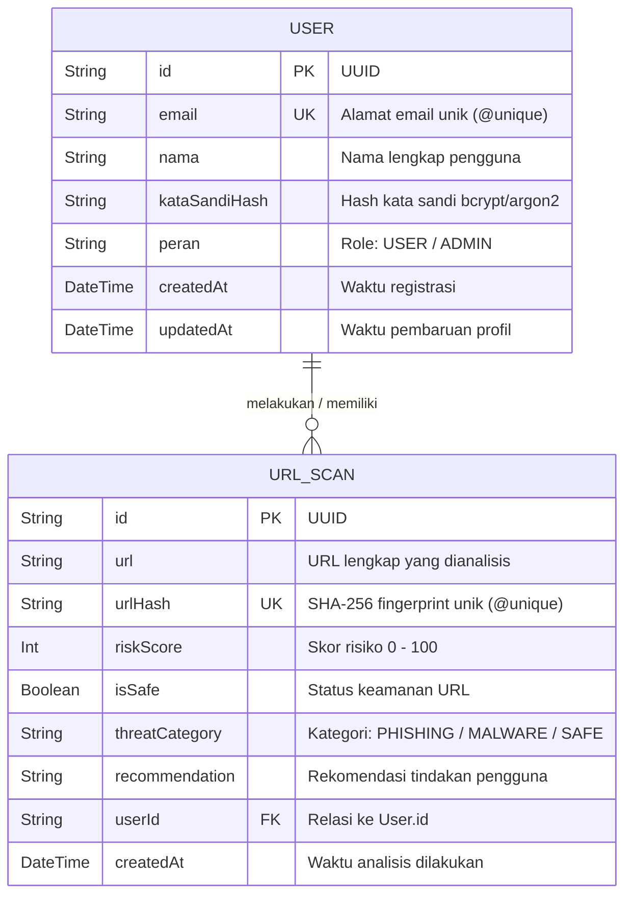

# Tugas Praktikum Basis Data — CyberShield & Prisma 7

Dokumen ini disusun untuk memenuhi tugas praktikum basis data pada proyek **CyberShield** (URL Security & Phishing Analyzer).

---

## 1. Diagram Dua Entitas Produk Berelasi 1:N

Pada arsitektur produk CyberShield, dua entitas inti yang berelasi 1:N (One-to-Many) adalah:
- **`User` (Pengguna / Analis Keamanan)**: Entitas induk (sisi 1) yang merepresentasikan akun pengguna/pengelola yang melakukan pemindaian keamanan URL.
- **`UrlScan` (Riwayat Analisis Keamanan URL)**: Entitas anak (sisi N) yang menyimpan hasil analisis URL, skor risiko (*risk score*), fingerprint hash SHA-256, dan rekomendasi keamanan.

### A. Diagram Entitas (Mermaid ERD)



### B. Representasi Skema Prisma 7 (`schema.prisma`)

```prisma
datasource db {
  provider = "postgresql" // atau "sqlite" / "mysql"
  url      = env("DATABASE_URL")
}

generator client {
  provider = "prisma-client-js"
}

model User {
  id            String    @id @default(uuid())
  email         String    @unique
  nama          String
  kataSandiHash String
  peran         String    @default("USER")
  createdAt     DateTime  @default(now())
  updatedAt     DateTime  @updatedAt

  // Relasi 1:N ke UrlScan
  scans         UrlScan[]

  @@map("users")
}

model UrlScan {
  id             String   @id @default(uuid())
  url            String
  urlHash        String   @unique // SHA-256 hash unik untuk mencegah duplikasi analisis identik
  riskScore      Int      // 0 - 100
  isSafe         Boolean
  threatCategory String   // "SAFE" | "PHISHING" | "SUSPICIOUS" | "MALWARE"
  recommendation String
  userId         String
  createdAt      DateTime @default(now())

  // Relasi ke User dengan foreign key dan aturan onDelete: Restrict
  user           User     @relation(fields: [userId], references: [id], onDelete: Restrict)

  @@index([userId])
  @@map("url_scans")
}
```

### C. Ringkasan Elemen Kunci Skema
1. **Primary Key (PK)**:
   - `User.id` (Tipe `String` dengan format UUID).
   - `UrlScan.id` (Tipe `String` dengan format UUID).
2. **Foreign Key (FK)**:
   - `UrlScan.userId` yang merujuk pada `User.id`.
3. **Constraint Unik (Unique Constraint)**:
   - `User.email` bertanda `@unique` untuk memastikan satu email hanya terdaftar pada satu akun.
   - `UrlScan.urlHash` bertanda `@unique` sebagai representasi *cryptographic fingerprint* SHA-256 dari URL masukan, menjamin integritas data dan mencegah duplikasi riwayat scan URL yang identik.

---

## 2. Aturan Penghapusan Relasi dan Justifikasi Nilai Data

### Aturan yang Dipilih: `Restrict` (`onDelete: Restrict`)

Pada relasi antara `User` dan `UrlScan`, aturan referensial penghapusan yang ditetapkan adalah **`Restrict`**.

### Alasan dari Sudut Pandang Nilai Data Produk CyberShield:

1. **Integritas Jejak Forensik dan Bukti Audit Keamanan (*Forensic & Audit Trail Integrity*)**:
   - CyberShield adalah aplikasi keamanan siber yang mendeteksi tautan phishing dan ancaman web. Setiap catatan `UrlScan` merepresentasikan temuan investigasi keamanan beserta bukti waktu (*timestamp*) dan *fingerprint* SHA-256.
   - Menggunakan `Cascade` sangat berbahaya karena jika akun seorang pengguna dihapus, seluruh riwayat pemindaian URL phishing yang pernah dilakukan pengguna tersebut akan ikut terhapus dari basis data. Hal ini membuka celah keamanan serius (*repudiation risk*), di mana seorang pelaku (*insider threat*) dapat menghapus akunnya sendiri untuk melenyapkan jejak kejahatan siber atau investigasi URL berbahaya yang pernah ia uji.
2. **Perlindungan Nilai Aset Data Intelijen Ancaman (*Threat Intelligence Asset Value*)**:
   - Berdasarkan dokumen *Asset Inventory* CyberShield, **Hasil Analisis URL (A02)** dan **URL yang Dianalisis (A01)** memiliki tingkat integritas tinggi (*Integrity rating: 3*). Kumpulan data URL phishing dan skor risikonya merupakan basis pengetahuan (*knowledge base*) berharga bagi CyberShield untuk melatih aturan deteksi baru di masa depan.
   - Dengan aturan `Restrict`, basis data secara tegas menolak perintah penghapusan pada akun `User` selama akun tersebut masih memiliki rekam jejak `UrlScan`.
3. **Pemberlakuan Kebijakan Penghapusan Terkelola (*Soft Delete / Deactivation Workflow*)**:
   - Daripada menghapus baris data secara permanen (*hard delete*), sistem mewajibkan penggunaan mekanisme *soft delete* (misal menandai `isActive: false` atau menganonimkan data pribadi) jika pengguna ingin menutup akun, sehingga keabsahan relasi data historis tetap terlindungi 100%.

> **Perbandingan dengan opsi lain**:
> - **Cascade**: Ditolak karena menyebabkan hilangnya bukti forensik dan penurunan drastis volume dataset ancaman platform (*catastrophic data loss*).
> - **SetNull**: Hanya dapat diterapkan jika `userId` bersifat opsional (`String?`). Meski data scan tersisa, relasi kepemilikan terputus sehingga mempersulit audit forensik mengenai pihak yang pertama kali memasukkan URL berbahaya tersebut ke sistem.

---

## 3. Daftar 10 Skenario Uji (8 CRUD dan 2 Relasi)

Berikut adalah tabel rancangan pengujian komprehensif yang mencakup 8 skenario CRUD (Create, Read, Update, Delete) dan 2 skenario relasi integritas referensial:

| No | Skenario Uji | Langkah Pengujian | Hasil yang Diharapkan |
|:--:|---|---|---|
| **1** | **[CRUD - Create]** Pembuatan akun pengguna baru dengan data valid | Jalankan `prisma.user.create()` dengan parameter `email: "analis@cybershield.id"`, `nama: "Silviana Ginting"`, dan `kataSandiHash: "hash123"`. | Baris data berhasil disimpan di tabel `users`, sistem mengembalikan objek `User` lengkap dengan ID berformat UUID dan timestamp `createdAt`. |
| **2** | **[CRUD - Create]** Pembuatan akun pengguna dengan email duplikat (Pelanggaran `@unique`) | Jalankan `prisma.user.create()` menggunakan email yang sudah terdaftar (`"analis@cybershield.id"`). | Operasi ditolak oleh DBMS; Prisma melempar eksepsi error `PrismaClientKnownRequestError` dengan kode `P2002` (*Unique constraint failed on the constraint: `users_email_key`*). Data duplikat tidak tersimpan. |
| **3** | **[CRUD - Read]** Pembacaan profil pengguna tunggal berdasarkan ID | Panggil `prisma.user.findUnique({ where: { id: targetUserId } })`. | Sistem mengembalikan objek data pengguna yang tepat sesuai `id`, atau `null` jika ID tidak ditemukan. |
| **4** | **[CRUD - Read]** Pembacaan daftar riwayat analisis URL dengan kriteria filter URL berisiko tinggi | Jalankan query `prisma.urlScan.findMany({ where: { isSafe: false, riskScore: { gte: 70 } } })`. | Mengembalikan *array* berisi seluruh data pemindaian URL yang tergolong berbahaya dengan skor risiko $\ge 70$, terurut berdasarkan `createdAt` terbaru. |
| **5** | **[CRUD - Update]** Pembaruan informasi nama pengguna | Panggil `prisma.user.update({ where: { id: targetUserId }, data: { nama: "Silviana M. Ginting" } })`. | Kolom `nama` pengguna berhasil diperbarui, kolom `updatedAt` otomatis terisi waktu terbaru, data atribut lain tetap utuh. |
| **6** | **[CRUD - Update]** Pembaruan hash URL scan ke nilai yang sudah ada (Pelanggaran `@unique`) | Jalankan `prisma.urlScan.update({ where: { id: scanId }, data: { urlHash: existingHash } })` dengan `urlHash` yang sudah tercatat pada scan lain. | Permintaan mutasi dibatalkan oleh Prisma dengan kode galat `P2002` pada field `urlHash`. Nilai data lama tidak berubah. |
| **7** | **[CRUD - Delete]** Penghapusan rekaman scan URL tunggal | Jalankan `prisma.urlScan.delete({ where: { id: scanId } })`. | Rekaman `UrlScan` dengan ID tersebut berhasil dihapus dari tabel `url_scans`. Verifikasi pembacaan setelahnya mengembalikan `null`. |
| **8** | **[CRUD - Delete]** Penghapusan rekaman pengguna dengan ID fiktif/tidak ada | Jalankan `prisma.user.delete({ where: { id: "non-existent-uuid" } })`. | Operasi gagal dan Prisma melempar error code `P2025` (*An operation failed because it depends on one or more records that were required but not found*). |
| **9** | **[Relasi - Create & Read]** Pembuatan record `UrlScan` terhubung ke User dan pembacaan bersarang (*eager loading*) | 1. Buat `UrlScan` dengan menyertakan `userId` dari user yang sah.<br>2. Eksekusi `prisma.user.findUnique({ where: { id: userId }, include: { scans: true } })`. | Record `UrlScan` berhasil tersimpan dengan relasi FK yang valid. Query pembacaan mengembalikan objek User dengan relasi array `scans` yang memuat record analisis yang baru saja dibuat. |
| **10** | **[Relasi - Restrict Enforcement]** Percobaan penghapusan User yang masih memiliki relasi data `UrlScan` aktif | Panggil `prisma.user.delete({ where: { id: userId } })` terhadap akun user yang masih memiliki minimal satu record anak pada tabel `url_scans`. | Operasi penghapusan **ditolak** oleh basis data demi menjaga integritas referensial. Prisma menghasilkan error code `P2003` (*Foreign key constraint violated on the field: `userId`*). Akun pengguna dan riwayat scan tetap aman. |

---

## 4. Urutan Perintah Prisma 7 Setelah Perubahan Skema

### Urutan Perintah Standar (Development Workflow):

```bash
# 1. Terapkan perubahan skema ke database dan buat file migrasi SQL
npx prisma migrate dev --name deskripsi_perubahan_skema

# 2. Perbarui Prisma Client agar definisi tipe TypeScript selaras
npx prisma generate

# 3. Inisialisasi atau sinkronkan data awal ke dalam database
npx prisma db seed
```

*(Catatan: Pada lingkungan *prototyping* cepat tanpa file riwayat migrasi, perintah langkah 1 dapat menggunakan `npx prisma db push`).*

---

### Alasan Mengapa `generate` dan `seed` Harus Dijalankan Eksplisit:

#### 1. Mengapa `prisma generate` Harus Dijalankan Eksplisit?
- **Pemisahan Lapisan Database (DDL) dan Lapisan Kode Klien (TypeScript Engine)**:
  Migrasi database (`prisma migrate`) beroperasi di sisi mesin basis data (DBMS) untuk mengubah struktur tabel, kolom, dan indeks. Sebaliknya, Prisma Client adalah paket pustaka TypeScript/JavaScript yang berada di dalam folder lokal `node_modules/@prisma/client` (atau direktori kustom).
- **Keandalan Lingkungan CI/CD dan Produksi**:
  Pada pipeline produksi atau *deployment* (`prisma migrate deploy`), Prisma Client **tidak dibuat otomatis** demi efisiensi dan keamanan pipeline. Jika `prisma generate` tidak dijalankan eksplisit, kode backend akan menggunakan definisi tipe (*stale types*) dan metode model lama yang sudah usang, memicu *runtime type error* atau *crash*.
- **Kompilasi Query Engine**:
  Prisma Client mengompilasi representasi DMMF (*Data Model Meta Format*) dan *runtime query engine* (Node-API library atau WebAssembly/WASM pada Prisma modern). Memanggil `prisma generate` secara eksplisit memberi kendali penuh dan deterministik kepada pengembang kapan *engine* TypeScript harus dikompilasi ulang.

#### 2. Mengapa `prisma db seed` Harus Dijalankan Eksplisit?
- **Pemisahan Operasi Skema Struktural vs Mutasi Status Data**:
  Perubahan skema (DDL) hanya mengatur cetak biru (*blueprint*) tabel. Menjalankan *seeding* data (DML) adalah operasi pengisian baris data. Mengotomatisasi seed setiap kali skema bermigrasi akan sangat berbahaya di lingkungan staging atau produksi karena dapat mengotori data nyata, mengubah status sistem yang sedang berjalan, atau menimbulkan latensi *deployment* yang tidak perlu.
- **Tindakan Sadar (*Intentional Action*)**:
  *Seeding* sering kali memuat akun default (seperti admin dengan password bawaan) atau data mock. Memisahkannya menjadi perintah eksplisit memastikan data *mock/initial* hanya dimasukkan ketika pengembang atau administrator sistem secara sadar dan sengaja membutuhkannya (misalnya saat baru mengklon proyek atau saat reset *test environment*).

---

## 5. Mengapa Seed dengan `upsert` Dapat Dijalankan Ulang (Re-runnable), Sedangkan `create` Biasa Tidak

Perbedaan mendasar antara `upsert` dan `create` biasa berakar pada konsep **Idempotensi (*Idempotency*)** dan penanganan **Constraint Unik (*Unique Constraints*)**:

### 1. Perilaku `create` Biasa (Tidak Idempoten):
- Metode `prisma.<model>.create()` selalu memetakan perintah SQL murni `INSERT INTO ...`.
- Pada eksekusi *seed* pertama kali di database kosong, proses berjalan sukses karena baris data baru belum ada.
- Namun, model basis data hampir selalu memiliki kolom unik atau Primary Key (seperti `id`, `email`, atau kode unik). Ketika perintah seed dijalankan **untuk kedua kalinya**, DBMS mendeteksi tabrakan nilai pada kolom unik tersebut dan melempar pelanggaran constraint unik:
  $$\text{Unique Constraint Violation} \longrightarrow \text{Prisma Error Code: } \mathbf{P2002}$$
- Akibatnya, eksekusi skrip *seed* langsung terhenti (*crashed*), menyisakan status basis data yang tidak tuntas atau terpotong (*inconsistent state*).
- Jika model tidak memiliki constraint unik sekalipun, `create` biasa akan menggandakan seluruh baris data secara liar setiap kali skrip dijalankan, memunculkan tumpukan data sampah (*duplicate data pollution*).

### 2. Perilaku `upsert` (Idempoten):
- Kata *upsert* merupakan gabungan dari **UPdate** dan in**SERT**. Operasi ini bersifat **idempoten**, yang artinya dapat dijalankan 1 kali, 10 kali, atau 100 kali dengan jaminan menghasilkan status akhir sistem yang konsisten tanpa menghasilkan galat.
- Sintaks `upsert` mewajibkan 3 argumen pengendali:
  ```ts
  await prisma.user.upsert({
    where: { email: "admin@cybershield.id" }, // Pencarian berbasis kolom unik
    update: {
      nama: "Administrator Utama", // Dijalankan jika data SUDAH ADA
    },
    create: {
      email: "admin@cybershield.id", // Dijalankan jika data BELUM ADA
      nama: "Administrator Utama",
      kataSandiHash: "...",
      peran: "ADMIN",
    },
  });
  ```
- **Alur Kerja Logis `upsert`**:
  1. Prisma terlebih dahulu mengecek keberadaan rekaman di basis data menggunakan kriteria pada klausa `where` (yang harus merujuk pada *unique field* atau *primary key*).
  2. **Jika data belum ditemukan**: Prisma mengeksekusi blok `create` (operasi `INSERT`) untuk memasukkan data awal.
  3. **Jika data sudah ada sebelumnya**: Prisma tidak melempar galat duplikasi, melainkan mengeksekusi blok `update` (operasi `UPDATE`) untuk memastikan atribut-atribut data tetap tersinkronisasi sesuai definisi seed terbaru (atau membiarkannya tetap utuh jika objek `update` kosong `{}`).
- **Kesimpulan**: Karena `upsert` menangani kemungkinan data sudah ada secara elegan tanpa melanggar batasan unik database, skrip *seeder* yang menggunakan `upsert` aman dijalankan berulang kali kapan saja (*safe & re-runnable*).

