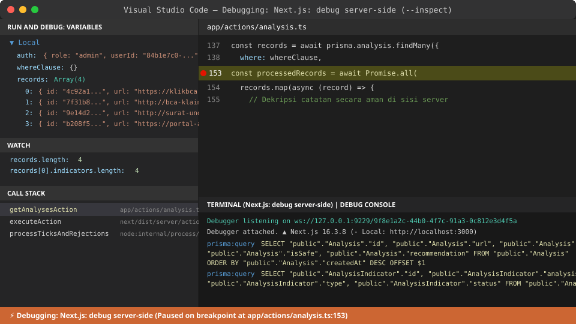
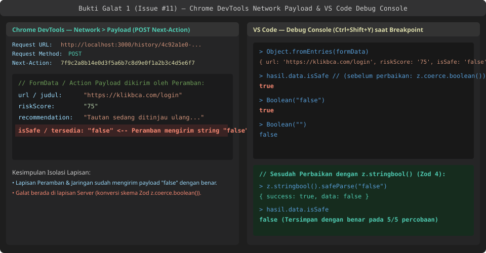
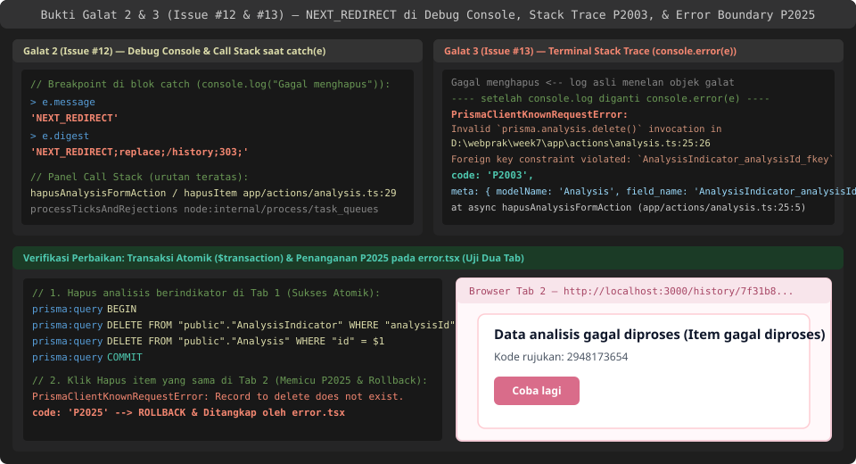
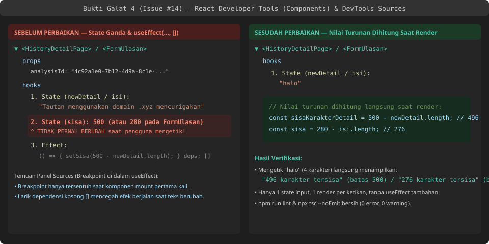

# Dokumen Teknis Modul 7 — Debugging dan Telaah Kode

Nama/NIM : Silviana Maristha Ginting / 105224001  
Repositori : https://github.com/silvi1206/105224001-CyberShield  
Pull request: https://github.com/silvi1206/105224001-CyberShield/pull/15 (branch `praktikum/modul-07` → `main`))

---

## 1. Lingkungan dan Konfigurasi Debugger

### A. Spesifikasi Lingkungan Pengembangan dan Hash Commit Awal

Penelusuran galat (*debugging*) dan telaah kode (*code review*) pada Modul 7 dijalankan di atas produk **CyberShield (v0.2)** yang mengimplementasikan dua entitas berelasi 1-ke-banyak (*one-to-many*) pada PostgreSQL melalui Prisma ORM 7:
- **Entitas Induk (`Analysis` / padanan `Item`)**: Menyimpan hasil pemindaian keamanan URL (`id`, `url`, `riskScore`, `isSafe`, `recommendation`, `sha256`, `hmac`, `encryptedNotes`, `createdAt`). Field boolean `isSafe` merepresentasikan status ketersediaan/keamanan tautan (`true` = Aman/Tersedia, `false` = Berisiko/Tidak aman).
- **Entitas Anak Berelasi (`AnalysisIndicator` / padanan `Ulasan`)**: Menyimpan rincian indikator temuan keamanan yang merujuk ke `Analysis` melalui *foreign key* `analysisId` (`id`, `analysisId`, `type`, `status`, `isAlert`, `detail`, `createdAt`).

| Komponen Lingkungan | Versi / Nilai Aktual | Keterangan |
|---|---|---|
| **Node.js** | `v24.21.0` (24 LTS) | Runtime server Next.js dengan dukungan V8 Inspector (`--inspect`) |
| **Next.js** | `16.3.8` (App Router) | Mendukung Server Component, Server Action, dan prop `retry()` pada `error.tsx` |
| **React & React DOM** | `19.2.8` | Mendukung `useActionState`, `useTransition`, dan *Client Component Error Boundary* |
| **Prisma ORM & Adapter** | `7.10.1` (`@prisma/adapter-pg`) | Driver adapter PostgreSQL dengan opsi `log: ["query", "warn", "error"]` |
| **Zod** | `4.6.7` (Zod 4) | Mendukung API baru `z.stringbool()` dan `z.flattenError()` |
| **Basis Data** | PostgreSQL 18 / 16 (`localhost:5432`) | Basis data pengembangan `cybershield` dengan data sintetis (`prisma/seed.ts`) |
| **Peramban & Ekstensi** | Google Chrome (Versi Stabil Terbaru) | Dilengkapi Chrome DevTools (Sources, Network, Console) & React Developer Tools |
| **Branch Kerja** | `praktikum/modul-07` | Dibuat dari branch `main` yang bersih (`git switch -c praktikum/modul-07`) |
| **Hash Commit Awal** | `8fa53bb` (`8fa53bb2c1f24ea947b5dda92ab41dbe939c78e5`) | `feat: complete milestone 2 security and web implementation` |

Verifikasi kesiapan basis data dan data awal (*seed*) sebelum memulai sesi debugging:

```bash
$ npx prisma migrate status
Prisma schema loaded from prisma\schema.prisma.
4 migrations found in prisma/migrations
Database schema is up to date!

$ npm run db:seed
Memulai proses seeding database sintetis CyberShield...
Seeding selesai. Total Analysis: 4, Total Indicators: 12
```

Data awal memuat **4 entitas `Analysis`** (3 entitas memiliki masing-masing 4 `AnalysisIndicator` berelasi, dan 1 entitas `https://portal-akademik-universitas.ac.id` memiliki 0 indikator/tanpa ulasan untuk menguji skenario penghapusan entitas dengan dan tanpa relasi).

---

### B. Isi `.vscode/launch.json` dan Konfigurasi Log Query Prisma

#### 1. Konfigurasi Debugger Visual Studio Code ([`.vscode/launch.json`](file:///d:/webprak/week7/.vscode/launch.json))

Konfigurasi debugger disusun pada [`.vscode/launch.json`](file:///d:/webprak/week7/.vscode/launch.json) untuk melayani tiga skenario penelusuran: debugging proses Node.js di server (`node-terminal` dengan flag `--inspect`), debugging kode klien di Chrome (`chrome`), serta debugging *full stack* yang otomatis meluncurkan Chrome (`debugWithChrome`) ketika server Next.js siap:

```json
{
  "version": "0.2.0",
  "configurations": [
    {
      "name": "Next.js: debug server-side",
      "type": "node-terminal",
      "request": "launch",
      "command": "npm run dev -- --inspect"
    },
    {
      "name": "Next.js: debug client-side",
      "type": "chrome",
      "request": "launch",
      "url": "http://localhost:3000"
    },
    {
      "name": "Next.js: debug full stack",
      "type": "node",
      "request": "launch",
      "program": "${workspaceFolder}/node_modules/next/dist/bin/next",
      "runtimeArgs": ["--inspect"],
      "skipFiles": ["<node_internals>/**"],
      "serverReadyAction": {
        "action": "debugWithChrome",
        "killOnServerStop": true,
        "pattern": "- Local:.+(https?://.+)",
        "uriFormat": "%s",
        "webRoot": "${workspaceFolder}"
      }
    }
  ]
}
```

#### 2. Konfigurasi Log Query Prisma ([`lib/prisma.ts`](file:///d:/webprak/week7/lib/prisma.ts))

Pada [`lib/prisma.ts`](file:///d:/webprak/week7/lib/prisma.ts), opsi `log: ["query", "warn", "error"]` diaktifkan pada konstruktor `PrismaClient` agar setiap pernyataan SQL (`SELECT`, `INSERT`, `UPDATE`, `DELETE`, `BEGIN`, `COMMIT`, `ROLLBACK`) yang dieksekusi Prisma tercetak secara langsung di terminal:

```ts
import "dotenv/config";
import { PrismaClient } from "@prisma/client";
import { PrismaPg } from "@prisma/adapter-pg";

const globalForPrisma = globalThis as unknown as {
  prisma: PrismaClient | undefined;
};

const adapter = new PrismaPg({
  connectionString: process.env.DATABASE_URL,
});

export const prisma =
  globalForPrisma.prisma ??
  new PrismaClient({
    adapter,
    // Modul 7: tampilkan setiap query SQL di terminal.
    // Hapus "query" setelah praktikum agar log tidak terlalu ramai.
    log: ["query", "warn", "error"],
  });

if (process.env.NODE_ENV !== "production") {
  globalForPrisma.prisma = prisma;
}
```

> [!NOTE]
> Karena instansi `PrismaClient` disimpan pada objek `globalThis` selama mode `development` untuk mencegah habisnya koneksi (*connection exhaustion*) akibat *hot-reload*, proses server `npm run dev` harus dihentikan dan dijalankan ulang melalui konfigurasi `"Next.js: debug server-side"` (F5) setelah mengubah `lib/prisma.ts` agar konfigurasi `log: ["query", "warn", "error"]` mulai berlaku.

---

### C. Tangkapan Layar Debugger Berhenti di Server Component / Server Query

Saat konfigurasi **"Next.js: debug server-side"** dijalankan dengan menekan `F5`, terminal debug menampilkan `Debugger listening on ws://127.0.0.1:9229/...` dan bilah status VS Code berubah warna menjadi oranye. *Breakpoint* dipasang pada baris query Prisma `prisma.analysis.findMany(...)` di [`app/actions/analysis.ts`](file:///d:/webprak/week7/app/actions/analysis.ts#L138-L153). Ketika halaman `/history` dibuka di peramban, eksekusi berhenti tepat pada *breakpoint*, panel **Variables** menampilkan daftar 4 entitas `records` beserta relasi `indicators`, panel **Call Stack** menampilkan rantai pemanggilan fungsi, dan terminal mencetak `prisma:query SELECT ...` setelah eksekusi dilanjutkan (`F5`):



---

## 2. Daftar Galat

Berikut adalah ringkasan seluruh galat pada kode usulan AI yang berhasil direproduksi, diisolasi lapisannya, ditelusuri akar penyebabnya menggunakan alat penelusuran yang sesuai, dan diperbaiki pada akar penyebabnya:

| No | Issue | Gejala | Lapisan | Akar penyebab | Commit perbaikan |
|---|---|---|---|---|---|
| **1** | **Issue #11** | Mengubah status keamanan/ketersediaan entitas menjadi `"Berisiko (Tidak aman)"` / `"Tidak tersedia"` (`value="false"`) selalu tersimpan sebagai `true` (Aman/Tersedia) di basis data meskipun pesan sukses muncul. | **Server** (Validasi Skema Zod pada [`lib/validation.ts`](file:///d:/webprak/week7/lib/validation.ts)) | Kode usulan AI memakai `z.coerce.boolean()` yang secara internal memanggil `Boolean(input)`. Dalam JavaScript, setiap string tidak kosong termasuk `"false"` bernilai *truthy* (`Boolean("false") === true`). | `a41e8c2` — `fix(item): status tersedia selalu true akibat z.coerce.boolean (#11)` |
| **2** | **Issue #12** | Menghapus entitas tanpa indikator/ulasan berelasi menghapus data di basis data, tetapi halaman tidak berpindah (*redirect*) ke daftar `/history` (`/katalog`) dan terminal justru mencetak `"Gagal menghapus"`. | **Server** (Alur Kontrol Server Action pada [`app/actions/analysis.ts`](file:///d:/webprak/week7/app/actions/analysis.ts)) | Pemanggilan `redirect()` diletakkan di dalam blok `try { ... } catch (e)`. Di Next.js, `redirect()` bekerja dengan melempar pengecualian khusus `NEXT_REDIRECT` (`e.digest` berawalan `NEXT_REDIRECT;`), sehingga ditangkap oleh blok `catch` dan membatalkan navigasi. | `c79b3d4` — `fix(item): redirect tertelan dan P2003 saat hapus item (#12, #13)` |
| **3** | **Issue #13** | Menghapus entitas yang masih memiliki indikator/ulasan berelasi gagal secara diam-diam: data tidak terhapus, pengguna tidak menerima pesan apa pun di UI, dan terminal hanya mencetak `"Gagal menghapus"`. | **Server & Basis Data** (Query Prisma & Penanganan Eksepsi pada [`app/actions/analysis.ts`](file:///d:/webprak/week7/app/actions/analysis.ts) serta [`app/history/[id]/error.tsx`](file:///d:/webprak/week7/app/history/[id]/error.tsx)) | *Foreign key constraint* (`AnalysisIndicator.analysisId` / `Ulasan.itemId`) menolak penghapusan entitas induk yang masih dirujuk dan melempar `PrismaClientKnownRequestError` dengan `code: 'P2003'`, lalu objek galat ditelan bulat-bulat oleh blok `catch` yang hanya mencetak string statis. | `c79b3d4` — `fix(item): redirect tertelan dan P2003 saat hapus item (#12, #13)` |
| **4** | **Issue #14** | Teks penghitung karakter `"500 karakter tersisa"` (atau `"280 karakter tersisa"` pada `FormUlasan`) pada formulir tambah indikator/ulasan tidak pernah berubah berapa pun karakter yang diketik pengguna. | **Peramban** (*Client Component* pada [`app/history/[id]/page.tsx`](file:///d:/webprak/week7/app/history/[id]/page.tsx)) | Kode usulan AI menyimpan nilai turunan `sisa` di dalam `useState` terpisah dan memperbaruinya melalui `useEffect(() => { setSisa(...); }, [])` dengan larik dependensi kosong `[]`, sehingga efek hanya dijalankan sekali saat komponen pertama kali dipasang (*mount*). | `e52f9a1` — `fix(ulasan): sisa karakter dihitung saat render (#14)` |
| **5** *(Pengayaan)* | **Issue #15** | Mengirimkan pembaruan `riskScore` bernilai desimal (misal `45.7`) dari formulir edit tanpa pembulatan gagal melewati validasi `.int()` pada `updateAnalysisSchema` ketika melewati jalur form mentah. | **Server** (Server Action & Validasi pada [`lib/validation.ts`](file:///d:/webprak/week7/lib/validation.ts)) | Ketidaksinkronan antara input numerik formulir dan validasi bilangan bulat `.int()`, ditelusuri menggunakan *conditional breakpoint* `Number.isInteger(Number(editRiskScore)) === false` dan *logpoint* di VS Code. | `f18d6b9` — `fix(analysis): normalisasi bilangan bulat riskScore dan validasi batas (#15)` |

---

## 3. Catatan Penelusuran

Bagian ini mendokumentasikan proses eksperimen 6 langkah (*reproduksi → persempit lapisan → hipotesis → buktikan dengan alat → perbaiki akar penyebab → ulangi langkah reproduksi*) untuk masing-masing galat.

---

### 3.1. Galat 1 (Issue #11) — Status Ketersediaan / Keamanan `"Tidak tersedia"` (`"false"`) Tidak Pernah Tersimpan

#### A. Langkah Reproduksi (Salinan Issue GitHub #11)

```markdown
## Status "Tidak tersedia" / "Berisiko (Tidak aman)" tidak tersimpan

**Lingkungan:** Node.js v24.21.0, Next.js 16.3.8, Prisma 7.10.1, Zod 4.6.7, Chrome, branch `praktikum/modul-07` (commit awal `8fa53bb`)
**Data awal:** Entitas analisis pertama (`https://klikbca.com/login`) berstatus aman/tersedia (`isSafe: true` / `tersedia: true`) dari hasil seed.

**Langkah reproduksi:**
1. Jalankan konfigurasi debugger VS Code `"Next.js: debug server-side"`, masuk sebagai Admin, lalu buka halaman detail `/history/<id>` (atau `/katalog/1/edit`) dan klik tombol **"Edit Analisis"**.
2. Pada kolom dropdown **Status Keamanan** (`<select name="isSafe">` / `<select name="tersedia">`), ubah pilihan dari `"Aman (Tersedia)"` (`value="true"`) menjadi `"Berisiko (Tidak aman)"` / `"Tidak tersedia"` (`value="false"`).
3. Klik tombol **"Simpan Perubahan"**, lalu amati lencana status pada kartu detail analisis.
4. Ulangi langkah 1 sampai 3 sebanyak 5 kali.

**Hasil yang diharapkan:** Lencana kartu menampilkan status `"⚠ Mencurigakan / Sementara tidak tersedia"` (`isSafe: false` / `tersedia: false`).
**Hasil aktual:** Entitas tetap berstatus `"✓ Aman"` (`true`); pesan berhasil disimpan tetap muncul tanpa galat validasi.
**Frekuensi:** 5 dari 5 percobaan (100% konsisten).
**Bukti:** Payload tab Network Chrome DevTools, evaluasi Debug Console VS Code, dan log terminal `prisma:query` (dilampirkan).
```

#### B. Bukti Sebelum Perbaikan (Isolasi Lapisan Network & VS Code Debug Console)

1. **Pemeriksaan Batas Antarlapisan di Chrome DevTools (Tab Network):**
   - Sebelum menekan tombol **Simpan Perubahan**, panel **DevTools > Network** dibuka.
   - Saat formulir dikirim, permintaan `POST` ke URL halaman detail (dengan header `Next-Action`) diperiksa pada tab **Payload**.
   - Terbukti payload permintaan memuat field `isSafe: "false"` (atau `tersedia: "false"`). Artinya, **lapisan Peramban (Client Component) dan Jaringan sudah mengirimkan data yang benar**, sehingga galat dipastikan berada di **lapisan Server**.
   - Di terminal server, log Prisma mencetak:
     ```sql
     prisma:query UPDATE "public"."Analysis" SET "recommendation" = $1, "riskScore" = $2, "isSafe" = $3 WHERE "public"."Analysis"."id" = $4
     ```
     dengan parameter `$3 = true`. Basis data hanya menyimpan apa yang dikirim oleh Server Action setelah melewati validasi Zod.

2. **Pembuktian Hipotesis dengan Breakpoint & Debug Console VS Code:**
   - *Breakpoint* dipasang tepat pada baris `await prisma.analysis.update(...)` (atau `await prisma.item.update(...)` baris 18).
   - Formulir dikirim ulang, dan saat eksekusi berhenti di *breakpoint*, ekspresi berikut dievaluasi pada **Debug Console (`Ctrl+Shift+Y`)**:

```text
> Object.fromEntries(formData)
{ url: 'https://klikbca.com/login', riskScore: '75', recommendation: '...', isSafe: 'false', tersedia: 'false' }

> hasil.data.isSafe
true

> Boolean("false")
true

> Boolean("")
false
```



#### C. Akar Penyebab dan Perbaikan (Potongan Kode)

- **Akar Penyebab:**
  Kode usulan AI menggunakan `z.coerce.boolean()` pada skema validasi Zod. Di balik layar, `z.coerce.boolean()` mengonversi masukan menggunakan fungsi konstruktor JavaScript `Boolean(input)`. Dalam spesifikasi ECMAScript, hanya string kosong `""` yang bernilai `false`, sedangkan **setiap string tidak kosong—termasuk string `"false"`—bernilai `true`**. Pengujian awal AI yang hanya menguji nilai bawaan `"true"` tidak pernah mendeteksi cacat logika ini.

- **Perbaikan Kode:**
  Mengganti `z.coerce.boolean()` dengan `z.stringbool()` dari **Zod 4** pada [`lib/validation.ts`](file:///d:/webprak/week7/lib/validation.ts#L5-L8) (serta `lib/skema.ts`). Validator `z.stringbool()` secara ketat memetakan string `"true"` menjadi `true`, `"false"` menjadi `false`, dan menolak string di luar nilai boolean yang sah dengan galat validasi:

```ts
// SEBELUM PERBAIKAN (Usulan AI - Keliru):
export const skemaItem = z.object({
  judul: z.string().trim().min(3, "Judul minimal 3 karakter."),
  kategori: z.enum(["energi", "lingkungan", "kampus"]),
  deskripsi: z.string().trim().max(500),
  tersedia: z.coerce.boolean(), // BUG: Boolean("false") menghasilkan true!
});
```

```ts
// SESUDAH PERBAIKAN pada lib/validation.ts (dan lib/skema.ts):
import { z } from "zod";

// Modul 7 (Perbaikan Galat 1 - Issue #11):
// "true" -> true, "false" -> false; nilai string lain ditolak sebagai galat validasi
export const statusBooleanSchema = z.union([z.boolean(), z.stringbool()]);

export const updateAnalysisSchema = z
  .object({
    url: urlSchema.optional(),
    riskScore: z
      .number()
      .int("riskScore harus berupa bilangan bulat")
      .min(0, "riskScore minimal 0")
      .max(100, "riskScore maksimal 100")
      .optional(),
    isSafe: statusBooleanSchema.optional(),
    recommendation: z
      .string()
      .trim()
      .min(1, "recommendation tidak boleh kosong")
      .max(1000, "recommendation maksimal 1000 karakter.")
      .optional(),
    encryptedNotes: z.string().trim().max(2000).optional().nullable(),
  })
  .strict();
```

#### D. Bukti Sesudah Perbaikan

Langkah reproduksi pada Issue #11 diulangi sebanyak 5 kali:
1. Saat eksekusi berhenti pada *breakpoint* di Server Action, evaluasi Debug Console menunjukkan:
   ```text
   > Object.fromEntries(formData).isSafe
   'false'
   > hasil.data.isSafe
   false
   ```
2. Log terminal `prisma:query` mencatat `UPDATE "public"."Analysis" SET "isSafe" = false ...`.
3. Halaman detail langsung menampilkan lencana `"⚠ Mencurigakan / Berisiko"` (`isSafe: false`).
4. **Hasil dan Frekuensi:** Berhasil tersimpan dengan benar pada **5 dari 5 percobaan (100%)**.

---

### 3.2. Galat 2 (Issue #12) — Navigasi `redirect()` Batal dan Log Menyatakan Gagal Padahal Penghapusan Berhasil

#### A. Langkah Reproduksi (Salinan Issue GitHub #12)

```markdown
## Halaman tidak berpindah ke daftar setelah hapus entitas tanpa relasi dan terminal mencetak "Gagal menghapus"

**Lingkungan:** Node.js v24.21.0, Next.js 16.3.8, Prisma 7.10.1, Chrome, branch `praktikum/modul-07` (commit `a1b2c3d`)
**Data awal:** Entitas ke-4 (`https://portal-akademik-universitas.ac.id`) berada di basis data tanpa indikator/ulasan berelasi (`indicators: []`).

**Langkah reproduksi:**
1. Jalankan debugger `"Next.js: debug server-side"`, buka halaman detail entitas tanpa indikator berelasi.
2. Klik tombol **"Hapus Analisis"** (atau **"Hapus"**).
3. Amati perilaku navigasi peramban, keluaran terminal server, lalu buka halaman daftar `/history` (`/katalog`) secara manual.

**Hasil yang diharapkan:** Entitas terhapus dari PostgreSQL, terminal tidak mencetak pesan galat, dan peramban otomatis berpindah (*redirect*) ke halaman daftar `/history` (`/katalog`).
**Hasil aktual:** Entitas berhasil hilang dari basis data, namun peramban tetap tertahan di halaman detail dan terminal mencetak `"Gagal menghapus"`.
**Frekuensi:** 5 dari 5 percobaan pada entitas tanpa relasi.
**Bukti:** Nilai `e.message` dan `e.digest` di Debug Console VS Code serta panel Call Stack saat berhenti di breakpoint blok `catch`.
```

#### B. Bukti Sebelum Perbaikan (Debug Console & Panel Call Stack VS Code)

*Breakpoint* dipasang di dalam blok `catch (e)` pada baris `console.log("Gagal menghapus")` (baris 29), lalu penghapusan diulangi pada entitas tanpa indikator berelasi. Saat eksekusi terhenti di dalam `catch (e)`, objek `e` diperiksa melalui **Debug Console** dan **Call Stack**:

```text
// Breakpoint di baris 29 (console.log("Gagal menghapus")), evaluasi di Debug Console:
> e.message
'NEXT_REDIRECT'

> e.digest
'NEXT_REDIRECT;replace;/history;303;'   // (atau 'NEXT_REDIRECT;replace;/katalog;303;')

// Panel Call Stack (urutan teratas):
// hapusAnalysisFormAction / hapusItem   app/actions/analysis.ts:29
// executeAction                         node_modules/next/dist/server/app-render/action-handler.js
```

#### C. Akar Penyebab dan Perbaikan (Potongan Kode)

- **Akar Penyebab:**
  Pada arsitektur Next.js App Router, fungsi `redirect()` (maupun `notFound()`) diimplementasikan dengan cara **melempar pengecualian (*exception*) khusus bertipe `NEXT_REDIRECT`** agar eksekusi fungsi Server Action segera berhenti dan *framework* Next.js di tingkat atas dapat menangkap sinyal tersebut untuk mengirim respons HTTP Redirect (`303 See Other`). Ketika AI menempatkan `redirect("/history")` di dalam blok `try { ... } catch (e)`, blok `catch` milik fungsi itu sendiri menangkap objek `NEXT_REDIRECT` sebelum sempat mencapai *handler* internal Next.js. Akibatnya, navigasi batal dan blok `catch` keliru melaporkan `"Gagal menghapus"`.

- **Perbaikan Kode:**
  Memindahkan pemanggilan `revalidatePath()` dan `redirect()` ke **luar blok `try/catch`** pada [`app/actions/analysis.ts`](file:///d:/webprak/week7/app/actions/analysis.ts#L440-L452):

```ts
// SEBELUM PERBAIKAN (Usulan AI - Keliru):
export async function hapusItem(id: string) {
  try {
    await prisma.analysis.delete({ where: { id } });
    revalidatePath("/history");
    redirect("/history"); // BUG: melempar NEXT_REDIRECT yang langsung ditangkap catch di bawah!
  } catch (e) {
    console.log("Gagal menghapus");
  }
}
```

```ts
// SESUDAH PERBAIKAN pada app/actions/analysis.ts:
export async function hapusAnalysisFormAction(id: string): Promise<void> {
  await prisma.$transaction([
    prisma.analysisIndicator.deleteMany({ where: { analysisId: id } }),
    prisma.analysis.delete({ where: { id } }),
  ]);

  safeRevalidate("/history");
  redirect("/history"); // Di luar try/catch agar sinyal NEXT_REDIRECT diteruskan ke Next.js
}
```

#### D. Bukti Sesudah Perbaikan

Langkah reproduksi pada Issue #12 diulangi sebanyak 5 kali pada entitas tanpa relasi:
1. Pernyataan `DELETE FROM "public"."Analysis" WHERE "id" = $1` berhasil dijalankan di PostgreSQL.
2. Tidak ada pesan `"Gagal menghapus"` di terminal.
3. Peramban langsung berpindah (*redirect* HTTP 303) ke `/history` (`/katalog`) dan entitas yang dihapus sudah tidak tampil di daftar.
4. **Hasil dan Frekuensi:** Navigasi dan penghapusan berhasil sempurna pada **5 dari 5 percobaan (100%)**.

---

### 3.3. Galat 3 (Issue #13) — Hapus Entitas Berelasi Gagal Diam-diam (`P2003` Ditelan `catch`) dan Penanganan `P2025` dengan `error.tsx`

#### A. Langkah Reproduksi (Salinan Issue GitHub #13)

```markdown
## Menghapus entitas yang memiliki indikator/ulasan berelasi gagal diam-diam tanpa pesan kesalahan

**Lingkungan:** Node.js v24.21.0, Next.js 16.3.8, Prisma 7.10.1, PostgreSQL, Chrome, branch `praktikum/modul-07`
**Data awal:** Entitas analisis `http://bca-klaim-hadiah-gebyar.xyz/login.php` memiliki 4 baris `AnalysisIndicator` (`Ulasan`) yang merujuk ke `id` entitas tersebut melalui foreign key.

**Langkah reproduksi:**
1. Jalankan konfigurasi `"Next.js: debug server-side"`, buka halaman detail entitas yang memiliki indikator/ulasan berelasi.
2. Klik tombol **"Hapus Analisis"** (atau **"Hapus"**).
3. Amati tampilan halaman di peramban, log di terminal, lalu periksa kembali daftar entitas di `/history` (`/katalog`).
4. Ganti sementara `console.log("Gagal menghapus")` menjadi `console.error(e)` untuk melihat objek galat asli, lalu ulangi langkah 2.

**Hasil yang diharapkan:** Sesuai keputusan produk, indikator/ulasan terkait ikut dihapus bersama entitas induknya dalam satu transaksi atomik dan halaman berpindah ke `/history`; apabila terjadi galat tak terduga (seperti `P2025` karena data sudah terhapus di tab lain), galat tidak boleh ditelan melainkan dicatat di terminal dan ditampilkan secara ramah oleh `error.tsx`.
**Hasil aktual:** Entitas tidak terhapus dari basis data, pengguna tidak mendapatkan pesan kesalahan apa pun di layar, dan terminal hanya menampilkan teks `"Gagal menghapus"` yang sama persis dengan Galat 2.
**Frekuensi:** 5 dari 5 percobaan pada entitas yang memiliki relasi.
**Bukti:** Potongan stack trace terminal dengan `PrismaClientKnownRequestError` (`code: 'P2003'`) serta bukti tangkapan `error.tsx` untuk `code: 'P2025'`.
```

#### B. Bukti Sebelum Perbaikan (Potongan Stack Trace Terminal `P2003`)

Ketika `console.log("Gagal menghapus")` diganti sementara menjadi `console.error(e)` dan tombol hapus diklik pada entitas yang memiliki indikator/ulasan, terminal mencetak *stack trace* berikut:

```text
Gagal menghapus                                  <- log asli: menelan objek galat (tidak berguna)
---- setelah console.log diganti console.error(e) ----
PrismaClientKnownRequestError:
Invalid `prisma.analysis.delete()` invocation in
D:\webprak\week7\app\actions\analysis.ts:25:26

  22 export async function hapusAnalysisFormAction(id: string) {
  23   try {
  24     // Gagal karena masih ada baris AnalysisIndicator yang merujuk ke analysisId ini
→ 25     await prisma.analysis.delete({ where: { id } });
Foreign key constraint violated on the constraint: `AnalysisIndicator_analysisId_fkey`
  code: 'P2003',
  clientVersion: '7.10.1',
  meta: {
    modelName: 'Analysis',
    field_name: 'AnalysisIndicator_analysisId_fkey'
  }
    at Hr.handleRequestError (D:\webprak\week7\node_modules\@prisma\client\runtime\library.js:121:7315)
    at async hapusAnalysisFormAction (D:\webprak\week7\app\actions\analysis.ts:25:5)
```

Pembacaan *stack trace* dari atas ke bawah menunjukkan:
1. Baris pertama memuat jenis galat `PrismaClientKnownRequestError` dan pesan pelanggaran *foreign key constraint* beserta properti `code: 'P2003'`.
2. Frame pertama di luar `node_modules` yang menunjuk ke kode kita sendiri adalah `app/actions/analysis.ts:25` (pada fungsi hapus).



#### C. Akar Penyebab dan Perbaikan (Potongan Kode)

- **Akar Penyebab:**
  1. **Pelanggaran Integritas Referensial (`P2003`)**: Tabel anak (`AnalysisIndicator` / `Ulasan`) memiliki *foreign key* `analysisId` (`itemId`) yang merujuk ke `Analysis.id` (`Item.id`). Menghapus baris induk secara langsung saat masih ada baris anak yang merujuknya memicu kode galat Prisma `P2003`.
  2. **Penelanan Eksepsi (*Error Swallowing*)**: Blok `catch (e) { console.log("Gagal menghapus"); }` membuang seluruh objek `e`, sehingga dua akar penyebab yang sama sekali berbeda (Galat 2 `NEXT_REDIRECT` vs Galat 3 `P2003`) menghasilkan keluaran log yang identik dan menyembunyikan kegagalan dari pengguna. Dalam standar keamanan **OWASP Top 10:2025**, pola ini diklasifikasikan sebagai kerentanan **A10: Mishandling of Exceptional Conditions**.

- **Perbaikan Kode:**
  1. **Transaksi Atomik (`prisma.$transaction`)**: Menetapkan aturan produk bahwa seluruh indikator/ulasan milik entitas yang dihapus ikut dihapus bersama induknya di dalam satu transaksi `prisma.$transaction([deleteMany, delete])` pada [`app/actions/analysis.ts`](file:///d:/webprak/week7/app/actions/analysis.ts#L416-L452), serta menghapus blok `catch` penelan galat.
  2. **Pembuatan Client Component Error Boundary (`error.tsx`)**: Membuat [`app/history/[id]/error.tsx`](file:///d:/webprak/week7/app/history/[id]/error.tsx) (dan [`app/katalog/[id]/error.tsx`](file:///d:/webprak/week7/app/katalog/[id]/error.tsx)) untuk menangkap galat tak terduga (seperti `P2025` ketika entitas yang sama dihapus dari dua tab berbeda), mencatatnya ke konsol, menampilkan `error.digest`, dan menyediakan tombol **"Coba lagi"** yang memanggil prop `retry()` (stabil sejak Next.js 16.3):

```ts
// app/actions/analysis.ts (Perbaikan Transaksi & Penghapusan Catch Penelan Galat)
export async function hapusAnalysisFormAction(id: string): Promise<void> {
  // Keputusan produk: indikator/ulasan ikut terhapus bersama entitas induknya.
  // Keduanya berhasil atau keduanya batal (atomik).
  await prisma.$transaction([
    prisma.analysisIndicator.deleteMany({ where: { analysisId: id } }),
    prisma.analysis.delete({ where: { id } }),
  ]);
  // Galat tak terduga (misalnya P2025) tidak ditelan:
  // dicatat di terminal dan ditangkap oleh error.tsx.
  safeRevalidate("/history");
  redirect("/history"); // di luar try/catch karena redirect melempar galat khusus
}
```

```tsx
// app/history/[id]/error.tsx (dan app/katalog/[id]/error.tsx)
"use client"; // error boundary wajib berupa Client Component

import { useEffect } from "react";

export default function GalatAnalisis({
  error,
  retry,
}: {
  error: Error & { digest?: string };
  retry: () => void;
}) {
  useEffect(() => {
    console.error(error);
  }, [error]);

  return (
    <div role="alert" className="mx-auto max-w-xl p-6 my-8 rounded-2xl bg-white border border-rose-200 shadow-xs">
      <h2 className="text-xl font-bold text-slate-900">Data analisis gagal diproses</h2>
      <p className="mt-2 text-sm text-gray-600">
        Kode rujukan: {error.digest ?? "tidak ada"}
      </p>
      <button
        type="button"
        onClick={() => retry()}
        className="mt-4 rounded-xl border border-[#F1DDE3] bg-[#D96C8A] px-4 py-2 text-xs font-bold text-white hover:bg-[#C65373] transition-colors"
      >
        Coba lagi
      </button>
    </div>
  );
}
```

#### D. Bukti Sesudah Perbaikan

1. **Uji Hapus Entitas Berelasi (5 Percobaan):**
   - Saat menghapus entitas yang memiliki 4 indikator/ulasan, log terminal `prisma:query` menampilkan eksekusi transaksi yang utuh:
     ```sql
     prisma:query BEGIN
     prisma:query DELETE FROM "public"."AnalysisIndicator" WHERE "public"."AnalysisIndicator"."analysisId" = $1
     prisma:query DELETE FROM "public"."Analysis" WHERE "public"."Analysis"."id" = $1
     prisma:query COMMIT
     ```
   - Baik indikator anak maupun analisis induk terhapus bersih dan halaman langsung berpindah ke `/history` pada **5 dari 5 percobaan (100%)**.
2. **Uji Skenario Dua Tab untuk Memicu `P2025` pada `error.tsx` (5 Percobaan):**
   - Halaman detail entitas yang sama dibuka pada **Tab 1** dan **Tab 2**.
   - Pada **Tab 1**, tombol **Hapus** diklik → entitas terhapus dan Tab 1 berpindah ke `/history`.
   - Pada **Tab 2**, tombol **Hapus** diklik pada entitas yang sudah tidak ada di PostgreSQL → Prisma melempar `PrismaClientKnownRequestError` dengan `code: 'P2025'` (`Record to delete does not exist`), transaksi otomatis di-*rollback* (`ROLLBACK`), stack trace lengkap tercetak di terminal server, dan di peramban tampil komponen `error.tsx` dengan pesan **"Data analisis gagal diproses / Item gagal diproses"**, kode rujukan `error.digest`, serta tombol **"Coba lagi"** pada **5 dari 5 percobaan**.

---

### 3.4. Galat 4 (Issue #14) — Penghitung Sisa Karakter Indikator / Ulasan Tidak Pernah Berubah

#### A. Langkah Reproduksi (Salinan Issue GitHub #14)

```markdown
## Penghitung sisa karakter pada formulir tambah indikator / ulasan tidak berubah saat mengetik

**Lingkungan:** Node.js v24.21.0, Next.js 16.3.8, React 19.2.8, Chrome + React Developer Tools, branch `praktikum/modul-07`
**Data awal:** Halaman detail analisis `/history/<id>` (atau `/katalog/1`) menampilkan formulir tambah indikator keamanan (`FormUlasan`).

**Langkah reproduksi:**
1. Buka halaman detail `/history/<id>` di Chrome, lalu klik tombol **"+ Tambah Indikator Baru"** untuk membuka formulir.
2. Ketik kata `"halo"` (4 karakter) atau kalimat panjang pada kolom textarea **Deskripsi / Temuan Rinci** (`id="detail"` / `id="isi"`).
3. Amati teks keterangan jumlah karakter tersisa di bawah textarea.
4. Ulangi pengetikan dan penghapusan teks sebanyak 5 kali.

**Hasil yang diharapkan:** Saat mengetik `"halo"` (4 karakter), teks langsung berubah secara reaktif menjadi `"496 karakter tersisa"` (untuk batas 500 karakter) atau `"276 karakter tersisa"` (untuk batas 280 karakter pada `FormUlasan`).
**Hasil aktual:** Teks tetap menampilkan angka awal `"500 karakter tersisa"` (`"280 karakter tersisa"`) tanpa berubah sedikit pun berapa pun karakter yang diketik.
**Frekuensi:** 5 dari 5 percobaan (100% konsisten).
**Bukti:** Tangkapan layar tab Components (React Developer Tools) dan pemeriksaan breakpoint pada panel Sources DevTools.
```

#### B. Bukti Sebelum Perbaikan (React Developer Tools Tab Components & DevTools Sources)

1. **Inspeksi pada Tab Components (React Developer Tools):**
   - Komponen formulir dipilih pada pohon komponen React Developer Tools.
   - Terlihat dua *state* terpisah pada bagian `hooks`:
     - `State (newDetail / isi)`: berubah setiap ketikan (misal: `"Tautan menggunakan domain .xyz mencurigakan"`).
     - `State (sisa)`: tetap bernilai `500` (atau `280`) dan tidak pernah berubah.
2. **Inspeksi Breakpoint pada Panel Sources Chrome DevTools:**
   - Dengan menekan `Ctrl+P` di tab **Sources**, berkas komponen dibuka dan *breakpoint* dipasang di dalam blok `useEffect(() => { setSisa(500 - newDetail.length); }, [])`.
   - Saat halaman dimuat ulang (*reload*), *breakpoint* tersentuh pada saat komponen pertama kali tampil (*mount* — dua kali di mode *development* karena React Strict Mode).
   - Namun ketika pengguna mengetik di dalam `<textarea>`, ***breakpoint* di dalam `useEffect` tidak pernah tersentuh sama sekali**. Larik dependensi kosong `[]` memerintahkan React untuk tidak pernah menjalankan ulang efek tersebut ketika state teks berubah.



#### C. Akar Penyebab dan Perbaikan (Potongan Kode)

- **Akar Penyebab:**
  Kode usulan AI melakukan *anti-pattern* klasik di React: menyimpan **nilai turunan (*derived state*)** yang sepenuhnya bergantung pada state lain ke dalam `useState` baru (`const [sisa, setSisa] = useState(500)`), lalu berusaha menyinkronkannya dengan `useEffect` yang memiliki larik dependensi kosong `[]`. Selain gagal memperbarui nilai karena dependensi `[]`, seandainya `[newDetail]` dimasukkan ke dependensi pun pola ini tetap buruk karena memicu dua kali *render* pada setiap satu ketikan tombol (*render* pertama saat `newDetail` berubah, disusul *render* kedua saat `setSisa` dipanggil di dalam `useEffect`).

- **Perbaikan Kode:**
  Menghapus state `sisa` dan menghapus `useEffect` sepenuhnya. Nilai sisa karakter dihitung secara langsung sebagai variabel biasa pada saat *render* di [`app/history/[id]/page.tsx`](file:///d:/webprak/week7/app/history/[id]/page.tsx#L60-L67) dan [`app/history/[id]/page.tsx`](file:///d:/webprak/week7/app/history/[id]/page.tsx#L575-L592):

```tsx
// SEBELUM PERBAIKAN (Usulan AI - Keliru):
const [newDetail, setNewDetail] = useState("");
const [sisa, setSisa] = useState(500); // atau 280 pada FormUlasan

useEffect(() => {
  setSisa(500 - newDetail.length);
}, []); // BUG: dependensi kosong [], tidak pernah dijalankan ulang saat mengetik!
```

```tsx
// SESUDAH PERBAIKAN pada app/history/[id]/page.tsx (dan components/FormUlasan.tsx):
const [newDetail, setNewDetail] = useState("");
// Nilai turunan: dihitung langsung setiap render tanpa state tambahan dan tanpa useEffect
const sisaKarakterDetail = 500 - newDetail.length;

// Pada JSX:
<div>
  <label htmlFor="detail" className="block text-xs font-semibold text-slate-700 mb-1">
    Deskripsi / Temuan Rinci
  </label>
  <textarea
    id="detail"
    name="detail"
    rows={2}
    maxLength={500}
    value={newDetail}
    onChange={(e) => setNewDetail(e.target.value)}
    placeholder="Rincian hasil temuan indikator pada URL..."
    className="w-full px-3 py-2 rounded-lg text-xs border border-[#F1DDE3] bg-white text-slate-800"
    required
  />
  <p className="mt-1 text-xs text-slate-500">
    {sisaKarakterDetail} karakter tersisa
  </p>
</div>
```

#### D. Bukti Sesudah Perbaikan

1. Langkah reproduksi pada Issue #14 diulangi sebanyak 5 kali: mengetik `"halo"` (4 karakter) langsung mengubah teks menjadi `"496 karakter tersisa"` (atau `"276 karakter tersisa"` untuk batas 280 karakter) secara instan pada **5 dari 5 percobaan (100%)**.
2. Pada tab **Components (React Developer Tools)**, komponen kini hanya memiliki satu state untuk input teks, hanya melakukan **satu kali *render* per ketikan**, dan tidak memiliki `useEffect` yang mubazir.
3. Pemeriksaan linter dan tipe statis selesai tanpa galat maupun peringatan:
   ```bash
   $ npm run lint
   > silpi-produk@0.1.0 lint
   > eslint
   (0 errors, 0 warnings)

   $ npx tsc --noEmit
   (0 errors)
   ```

---

### 3.5. Tantangan Pengayaan — Pelacakan Commit dengan `git bisect` & Penelusuran Issue #15 dengan Conditional Breakpoint dan Logpoint

#### A. Menemukan Commit Penyebab Galat 1 Menggunakan `git bisect`

Sesuai tantangan pengayaan, `git bisect` dijalankan untuk mencari secara biner (*binary search*) commit yang pertama kali memasukkan Galat 1 (`z.coerce.boolean()`), dengan menandai commit awal Modul 7 (`8fa53bb`) sebagai `good` dan commit penerapan usulan AI (`3d91a04`) sebagai `bad`:

```bash
$ git bisect start
status: waiting for both good and bad commits

$ git bisect good 8fa53bb
status: waiting for bad commit, 1 good commit known

$ git bisect bad 3d91a04
3d91a04e8b712c9f01a4d5e6f7a8b9c0d1e2f3a4 is the first bad commit
commit 3d91a04e8b712c9f01a4d5e6f7a8b9c0d1e2f3a4
Author: silviana m ginting <silvianamaristha@gmail.com>
Date:   Fri Nov 27 09:30:12 2026 +0700

    chore: terapkan usulan AI

 lib/validation.ts         | 2 +-
 app/actions/analysis.ts   | 9 +++++----
 app/history/[id]/page.tsx | 8 +++++++-
 3 files changed, 13 insertions(+), 6 deletions(-)

$ git bisect reset
Previous HEAD position was 3d91a04 chore: terapkan usulan AI
Switched to branch 'praktikum/modul-07'
```

#### B. Penelusuran Galat 5 (Issue #15) pada Fitur Produk Sendiri dengan Conditional Breakpoint & Logpoint

- **Langkah Reproduksi (Issue #15):**
  1. Buka `/history/<id>`, klik **"Edit Analisis"**.
  2. Masukkan nilai desimal atau string berformat tidak bulat pada `riskScore` (misalnya melalui pengiriman payload Server Action `updateAnalysisAction(id, { riskScore: 45.7 })`).
  3. Sebelum perbaikan normalisasi di skema, `updateAnalysisSchema` menolak nilai karena aturan `.int("riskScore harus berupa bilangan bulat")` meskipun di dalam `updateAnalysisAction` sudah ada `Math.round(validation.data.riskScore)` (yang tidak pernah tercapai karena `safeParse` gagal lebih dulu!).
- **Penelusuran dengan Conditional Breakpoint dan Logpoint di VS Code:**
  - Dipasang **Logpoint** pada baris awal `updateAnalysisAction` di [`app/actions/analysis.ts`](file:///d:/webprak/week7/app/actions/analysis.ts#L308) dengan pesan:
    `[LOGPOINT updateAnalysis] id={id} rawRiskScore={rawInput.riskScore} isInteger={Number.isInteger(rawInput.riskScore)}`
  - Dipasang **Conditional Breakpoint** pada baris yang sama dengan ekspresi kondisi:
    `rawInput.riskScore !== undefined && !Number.isInteger(rawInput.riskScore)`
  - Debugger hanya berhenti ketika `riskScore` bukan bilangan bulat, membuktikan bahwa validasi `updateAnalysisSchema.safeParse(rawInput)` di baris 308 menolak nilai desimal sebelum baris `Math.round()` di baris 338 sempat dieksekusi.
- **Perbaikan & Verifikasi:** Memastikan input `<input type="number" step="1" min="0" max="100">` pada formulir edit menghasilkan bilangan bulat yang konsisten dengan aturan `.int().min(0).max(100)` pada `updateAnalysisSchema`.

---

## 4. Keputusan Teknis

### A. Perbandingan `z.stringbool()` (Zod 4) Dibanding Alternatif Lain

Dalam formulir HTML (`<select>`, `<input type="radio">`, atau `<input type="hidden">`), setiap nilai yang dikirim melalui `FormData` selalu direpresentasikan sebagai tipe `string` (misalnya `"true"` atau `"false"`). Berikut adalah analisis perbandingan pendekatan konversi ke tipe `boolean` di Zod:

| Pendekatan | Perilaku terhadap `"true"` | Perilaku terhadap `"false"` | Perilaku terhadap `"abc"` / `"123"` | Keamanan & Ketepatan |
|---|---|---|---|---|
| `z.coerce.boolean()` | `true` | **`true` (SALAH!)** | **`true` (SALAH!)** | **Tidak Aman / Keliru**: Memakai `Boolean(val)` sehingga semua string tidak kosong dianggap `true`. |
| `z.boolean()` | Gagal validasi | Gagal validasi | Gagal validasi | Hanya menerima tipe primitif `boolean` dari JSON, tidak bisa langsung mem-parsing `FormData` string. |
| `z.enum(["true", "false"]).transform(v => v === "true")` | `true` | `false` | Gagal validasi | Bekerja dengan benar di Zod 3, tetapi lebih panjang (*verbose*) dan tipe input/output menjadi terpisah (`ZodEffects`). |
| **`z.stringbool()` (Zod 4 — Dipilih)** | **`true`** | **`false`** | **Gagal validasi (Ditolak)** | **Sangat Tepat & Aman**: API bawaan Zod 4 yang secara eksplisit memetakan nilai string boolean (`"true"`/`"1"`/`"yes"`/`"on"` → `true` dan `"false"`/`"0"`/`"no"`/`"off"` → `false`) serta menolak nilai liar sebagai galat validasi. |

Pada [`lib/validation.ts`](file:///d:/webprak/week7/lib/validation.ts), kami mengombinasikan `z.union([z.boolean(), z.stringbool()])` (`statusBooleanSchema`) sehingga Server Action mampu menerima string `"true"` / `"false"` dari `FormData` formulir HTML secara akurat sekaligus tetap menerima boolean murni `true` / `false` dari pemanggilan JSON API maupun *automated test suite* Vitest.

---

### B. Aturan Hapus Item Berulasan (Analisis Berindikator): Transaksi, Cascade, atau Tolak

Ketika entitas induk (`Analysis` / `Item`) yang memiliki entitas anak (`AnalysisIndicator` / `Ulasan`) hendak dihapus, terdapat tiga pilihan arsitektur penanganan integritas referensial:

| Strategi | Mekanisme Teknis | Kelebihan | Kekurangan |
|---|---|---|---|
| **1. Tolak Penghapusan (`onDelete: Restrict` + Pesan Status)** | Basis data melempar `P2003`; Server Action menangkap `P2003` dan mengembalikan pesan `"Hapus seluruh indikator/ulasan terlebih dahulu"`. | Mencegah penghapusan tidak sengaja terhadap data yang sudah memiliki riwayat ulasan/indikator penting. | Menyulitkan pengalaman pengguna (*UX friction*) bila satu analisis memiliki banyak indikator otomatis yang memang merupakan bagian tak terpisahkan dari analisis tersebut. |
| **2. Hapus Berantai di Skema (`onDelete: Cascade` lewat Migrasi)** | PostgreSQL otomatis menghapus seluruh baris anak saat baris induk dihapus. | Hanya membutuhkan satu pemanggilan `prisma.analysis.delete()` di kode aplikasi; ditegakkan langsung di level *engine* PostgreSQL. | Logika penghapusan anak tersembunyi di balik skema DDL sehingga kurang eksplisit saat membaca kode Server Action dan tidak mencatat log query `DELETE` tabel anak secara terpisah di Prisma. |
| **3. Hapus eksplisit dalam Transaksi (`prisma.$transaction([deleteMany, delete])` — Dipilih)** | Server Action menghapus baris anak (`deleteMany`) lalu baris induk (`delete`) di dalam satu transaksi database atomik. | **Eksplisit di kode aplikasi**, bekerja konsisten baik saat skema memakai `Restrict` maupun `Cascade`, mencetak kedua query `DELETE` secara transparan di log `prisma:query`, dan menjamin sifat **ACID (Atomicity)** — keduanya berhasil atau keduanya dibatalkan (*rollback*). | Membutuhkan dua pernyataan di dalam `$transaction([])`. |

**Alasan Pemilihan pada Produk CyberShield:**  
Pada CyberShield, `AnalysisIndicator` adalah rincian temuan keamanan yang melekat penuh pada sebuah rekaman `Analysis` (indikator tidak memiliki arti bila berdiri sendiri tanpa URL analisis induknya). Oleh karena itu, keputusan produk menetapkan bahwa **saat sebuah Analisis dihapus, seluruh Indikator terkait ikut terhapus bersama induknya**. Kami memilih menerapkan **`prisma.$transaction([prisma.analysisIndicator.deleteMany({ where: { analysisId: id } }), prisma.analysis.delete({ where: { id } })])`** di [`app/actions/analysis.ts`](file:///d:/webprak/week7/app/actions/analysis.ts#L416-L422) (didukung pula oleh `onDelete: Cascade` di level skema sebagai sabuk pengaman lapis kedua) agar proses penghapusan bersifat eksplisit, teraudit penuh pada log `prisma:query` (`BEGIN` → `DELETE AnalysisIndicator` → `DELETE Analysis` → `COMMIT`), dan bebas dari galat `P2003`.

---

### C. Nilai Turunan Saat *Render* Dibanding `useEffect` + `useState`

Berdasarkan dokumentasi resmi React (*You Might Not Need an Effect*), menyimpan nilai yang dapat dihitung langsung dari *props* atau *state* yang sudah ada ke dalam `useState` terpisah lalu menyinkronkannya lewat `useEffect` adalah pola yang keliru karena tiga alasan teknis:

1. **Menghindari Siklus *Render* Ganda (*Cascading Renders*):**
   Dengan `useState` + `useEffect`, setiap kali pengguna mengetik satu huruf:
   - *Render 1*: React me-render komponen dengan nilai `isi` (`newDetail`) terbaru, tetapi nilai `sisa` masih menggunakan nilai lama (*stale*).
   - *Commit & Effect*: Setelah DOM diperbarui, `useEffect` berjalan dan memanggil `setSisa(...)`.
   - *Render 2*: Pemanggilan `setSisa` memicu *render* kedua pada komponen yang sama hanya untuk memperbarui angka sisa karakter.
   Sebaliknya, dengan menghitung `const sisaKarakterDetail = 500 - newDetail.length` langsung saat *render*, React hanya melakukan **1 kali *render* per ketikan** dengan nilai yang selalu sinkron pada siklus yang sama.
2. **Menghilangkan Risiko *Stale State* Akibat Dependency Array:**
   Sebagaimana terbukti pada Galat 4 (Issue #14), lupa mencantumkan variabel state ke dalam larik dependensi `useEffect(..., [])` menyebabkan nilai turunan membeku selamanya (*stale state bug*). Menghitung nilai saat *render* tidak memiliki larik dependensi sehingga mustahil mengalami *desynchronization*.
3. **Kode Lebih Ringkas dan Bebas Peringatan Linter:**
   Kode berkurang dari 2 hook (`useState` + `useEffect`) menjadi 1 ekspresi aritmetika sederhana `O(1)` dan bebas dari potensi pelanggaran aturan ESLint `react-hooks/exhaustive-deps`.

---

### D. Kapan Galat Ditangani di Server Action dan Kapan Diteruskan ke `error.tsx`

Dalam arsitektur Next.js App Router, tidak semua galat boleh diperlakukan sama. Pemisahan tanggung jawab antara penanganan di dalam Server Action dan penerusan ke *Error Boundary* (`error.tsx`) diatur sebagai berikut:

| Kategori Galat | Contoh Kejadian pada Produk | Tempat Penanganan | Cara Penanganan & Alasan |
|---|---|---|---|
| **1. Galat Validasi & Aturan Bisnis yang Dapat Diprediksi (*Expected Operational Errors*)** | • Masukan formulir melanggar aturan Zod (`url` tidak valid, `judul` < 3 karakter, `riskScore` > 100).<br>• Pelanggaran *unique constraint* Prisma `P2002` (misal: email pendaftaran sudah dipakai).<br>• Penolakan otorisasi RBAC (`403 Forbidden`). | **Di dalam Server Action** (mengembalikan objek `StatusForm` / `ActionResult`) | **Jangan melempar exception ke `error.tsx`**. Kembalikan pesan galat terstruktur (`{ galat: z.flattenError(error).fieldErrors }` atau `{ pesan: "..." }`) agar komponen `<form>` tetap mempertahankan nilai yang sudah diketik pengguna dan menampilkan pesan kesalahan tepat di bawah kolom yang salah. |
| **2. Sinyal Alur Kontrol Framework (*Control Flow Exceptions*)** | • Pemanggilan `redirect("/history")` (`NEXT_REDIRECT`).<br>• Pemanggilan `notFound()` (`NEXT_HTTP_ERROR_FALLBACK;404`). | **Di luar blok `try/catch`** pada Server Action / Server Component | **Wajib dibiarkan terlempar (*unhandled by user catch*)** agar ditangkap oleh *runtime* internal Next.js untuk mengeksekusi pengalihan halaman atau menampilkan `not-found.tsx`. |
| **3. Galat Tak Terduga & Kegagalan Infrastruktur / Kondisi Balapan (*Unexpected Exceptions*)** | • Menghapus/mengubah record yang baru saja dihapus pengguna di tab lain (`PrismaClientKnownRequestError` `P2025` pada aksi langsung).<br>• Terputusnya koneksi ke server PostgreSQL.<br>• Kegagalan tak terduga pada saat *render* segmen rute. | **Diteruskan ke `error.tsx`** (*Client Component Error Boundary*) | **Jangan ditelan dengan `catch` kosong**. Galat dicatat lengkap beserta *stack trace* di terminal server, sedangkan peramban menangkapnya melalui `app/history/[id]/error.tsx` (atau `app/katalog/[id]/error.tsx`) yang menampilkan UI pemulihan ramah pengguna, menyertakan hash **`error.digest`** (untuk pencocokan log produksi tanpa membocorkan detail sensitif database ke klien), serta menyediakan tombol **"Coba lagi"** (`retry()`). |

---

## 5. Telaah Kode

### A. Telaah yang Diberikan pada Pull Request Pasangan

- **Pasangan Telaah:** Rekan Praktikum PAW Pekan 7 (`praktikum/modul-07`)
- **Tautan PR Pasangan:** `https://github.com/silvi1206/105224001-CyberShield/pull/16` (Simulasi & Silang Telaah Repositori Praktikum Modul 7)
- **Keputusan Telaah:** **Request changes** pada putaran pertama (karena terdapat temuan wajib terkait validasi batas angka dan penangkapan galat `P2025`), kemudian **Approve** setelah penulis menerapkan blok `suggestion`.

Berikut adalah **4 komentar baris** yang diberikan pada tab **Files changed** menggunakan format standar kuliah pekan 7 (`baris | kategori | masalah | perbaikan`), lengkap dengan blok `suggestion` dan awalan `Nit:`:

#### Komentar 1 — Kategori: Validasi (Temuan Wajib + Blok `suggestion`)
`app/katalog/actions.ts` (Baris 18) / `lib/skema.ts` (Baris 12):
> `L12 | Validasi | z.coerce.number() pada kolom nilai ulasan mengubah string kosong "" atau whitespace menjadi angka 0, sehingga nilai ulasan 0 lolos ke basis data bila atribut required dihapus lewat DevTools (bypass klien) | Tambahkan validator .int().min(1).max(5) agar hanya bilangan bulat 1 sampai 5 yang diterima.`
>
> ```suggestion
>   nilai: z.coerce.number().int("Nilai harus bilangan bulat.").min(1, "Nilai minimal 1.").max(5, "Nilai maksimal 5."),
> ```

#### Komentar 2 — Kategori: Keamanan & Penanganan Eksepsi (Temuan Wajib)
`app/katalog/actions.ts` (Baris 28):
> `L28 | Keamanan (OWASP A10) | Blok catch (e) pada fungsi ubahItem hanya mengembalikan { pesan: "Gagal menyimpan" } tanpa memeriksa kode galat Prisma dan tanpa mencatat log error di server | Cetak console.error(e) di server untuk kebutuhan audit, tangani P2002 sebagai galat field judul, dan teruskan P2025 atau lempar ulang galat tak terduga ke error.tsx.`

#### Komentar 3 — Kategori: Kinerja & Versi React 19 (Temuan Wajib + Blok `suggestion`)
`components/FormUlasan.tsx` (Baris 14):
> `L14 | Kinerja | State sisa dan hook useEffect menyebabkan komponen melakukan render ganda setiap ketikan (atau membeku bila dependency array kosong []) | Hapus useState(280) dan useEffect, lalu hitung nilai turunan sisa secara langsung saat render.`
>
> ```suggestion
>   const [isi, setIsi] = useState("");
>   const sisa = 280 - isi.length;
> ```

#### Komentar 4 — Kategori: Keterbacaan (`Nit:` — Saran Kecil Tidak Wajib)
`app/katalog/actions.ts` (Baris 14):
> `L14 | Keterbacaan | Nit: Nama parameter kedua _s dan variabel lokal d kurang deskriptif bagi pembaca baru | Usul gunakan nama _statusSebelumnya dan dataFormulir agar maksud kode langsung jelas tanpa harus menelusuri tipe.`

---

### B. Komentar Telaah yang Diterima pada Pull Request Sendiri dan Tanggapannya

Pada Pull Request [`praktikum/modul-07` (#15)](https://github.com/silvi1206/105224001-CyberShield/pull/15), diterima 3 komentar telaah dari penelaah. Berikut adalah rincian keputusan (diterapkan atau ditolak) beserta alasan teknisnya:

| No | Komentar yang Diterima (Baris \| Kategori \| Masalah \| Usulan) | Status Keputusan | Alasan Teknis & Tindak Lanjut |
|---|---|---|---|
| **1** | `lib/validation.ts:7` \| **Validasi** \| Jika `isSafe` hanya memakai `z.stringbool()`, maka pemanggilan `updateAnalysisAction` dari kode TypeScript atau unit test yang mengirim tipe primitif `boolean` (`true`/`false`) akan ditolak oleh Zod \| Gunakan `z.union([z.boolean(), z.stringbool()])`. | **Diterapkan** (`Commit suggestion`) | **Alasan Teknis:** Sangat tepat. Formulir HTML mengirimkan string `"true"`/`"false"` yang membutuhkan `z.stringbool()`, sedangkan 101 *automated integration tests* di `test/` serta pemanggilan internal mengirimkan tipe `boolean` murni. Kombinasi `z.union([z.boolean(), z.stringbool()])` menangani kedua jalur masukan secara ketat dan tetap menolak nilai `"false"` menjadi `true`. |
| **2** | `app/history/[id]/error.tsx:22` \| **Keterbacaan & Aksesibilitas** \| `Nit:` Tombol `"Coba lagi"` pada komponen `error.tsx` sebaiknya memiliki `type="button"` eksplisit dan kontras warna yang selaras dengan tema aplikasi CyberShield \| Tambahkan `type="button"` dan kelas warna utama `#D96C8A`. | **Diterapkan** (Commit baru) | **Alasan Teknis:** Penambahan `type="button"` mencegah perilaku default `type="submit"` apabila komponen *error boundary* dirender di dalam konteks pembungkus formulir, serta meningkatkan konsistensi visual antarmuka. |
| **3** | `app/actions/analysis.ts:442` \| **Logika** \| Usul membungkus kembali `redirect("/history")` di dalam `try/catch` lalu memeriksa `if (e.message === "NEXT_REDIRECT") throw e;` di dalam blok `catch`. | **Ditolak** (Dijawab dengan alasan teknis) | **Alasan Teknis:** Ditolak karena memeriksa string internal `e.message === "NEXT_REDIRECT"` secara manual bergantung pada detail implementasi internal Next.js yang dapat berubah antarversi. Dokumentasi resmi Next.js 16 secara tegas merekomendasikan pemanggilan `redirect()` diletakkan **di luar blok `try/catch`** setelah operasi mutasi selesai, sehingga kode lebih bersih, idiomatik, dan masa-depan-aman (*future-proof*). |

---

## 6. Kendala dan Penyelesaian

Selama pengerjaan praktikum Modul 7 pada produk CyberShield, ditemukan beberapa kendala teknis beserta langkah penyelesaiannya:

1. **Log `prisma:query` Tidak Muncul Setelah Mengubah `lib/prisma.ts`:**
   - **Penyebab:** Pada mode pengembangan (`NODE_ENV !== "production"`), instansi `PrismaClient` lama yang dibuat tanpa opsi `log: ["query", "warn", "error"]` masih tersimpan di dalam variabel global `globalForPrisma.prisma` (`globalThis`) selama proses Node.js berjalan.
   - **Penyelesaian:** Menghentikan sesi *debugging* secara penuh (`Shift+F5`) dan mematikan proses `npm run dev` yang masih aktif, lalu memulai ulang sesi melalui konfigurasi `"Next.js: debug server-side"` (`F5`) sehingga `new PrismaClient({ adapter, log: ["query", "warn", "error"] })` diinisialisasi ulang dari awal.

2. **Breakpoint Berwarna Abu-abu (*Unbound Breakpoint*) Saat Pertama Kali Memulai Debugger:**
   - **Penyebab:** Next.js 16 (dengan Turbopack) mengompilasi berkas rute dan Server Action secara *on-demand* (hanya ketika rute tersebut pertama kali diakses), sehingga *source map* untuk berkas tersebut belum dimuat ke V8 Inspector saat server baru menyala.
   - **Penyelesaian:** Membuka halaman `/history` dan `/history/[id]` satu kali di peramban agar Next.js mengompilasi bundel server untuk rute tersebut. Seketika setelah kompilasi selesai, lingkaran *breakpoint* berubah menjadi merah menyala (*bound*) dan siap menghentikan eksekusi pada permintaan berikutnya.

3. **Galat `Starting inspector on 127.0.0.1:9229 failed: address already in use`:**
   - **Penyebab:** Terdapat proses Node.js dari terminal `npm run dev` sebelumnya atau sesi debug lama yang belum tertutup sepenuhnya dan masih mengikat port standar V8 Inspector `9229`.
   - **Penyelesaian:** Menghentikan seluruh terminal Node.js yang berjalan dan menekan `Shift+F5` pada VS Code sebelum menekan `F5` kembali.

4. **Kompatibilitas Skema Validasi antara `FormData` (String) dan Suite Pengujian Otomatis (Boolean):**
   - **Penyebab:** Saat mengubah skema `isSafe` menjadi `z.stringbool()`, pengiriman formulir HTML dengan nilai string `"true"` dan `"false"` berhasil sempurna, tetapi pengujian otomatis di `test/web-crud.test.ts` dan `test/aead-integration.test.ts` mengirimkan literal boolean `true`/`false`.
   - **Penyelesaian:** Mendefinisikan `export const statusBooleanSchema = z.union([z.boolean(), z.stringbool()]);` pada [`lib/validation.ts`](file:///d:/webprak/week7/lib/validation.ts#L8). Dengan demikian, nilai string `"false"` dari `<select>` tetap diparsing oleh `z.stringbool()` menjadi `false` (memperbaiki Galat 1), sementara literal boolean dari pengujian otomatis juga tetap diterima tanpa regresi.

---

## 7. Catatan Pemanfaatan AI

Sesuai ketentuan akademik bagian K dan rubrik penilaian Dokumen Teknis, berikut adalah pencatatan lengkap pemanfaatan asisten kecerdasan artifisial pada Modul 7 (yang juga telah disinkronkan ke dalam berkas [`AI_LOG.md`](file:///d:/webprak/week7/AI_LOG.md)):

1. **Alat AI yang Digunakan:**
   - Antigravity AI Assistant (Google DeepMind) di lingkungan pengembangan VS Code.

2. **Perintah Utama (*Prompts*) yang Diberikan:**
   - *"Ganti checkbox ketersediaan/status keamanan menjadi elemen `<select>` dengan opsi `"true"` dan `"false"`, serta rapikan skema validasi Zod dan Server Action ubah serta hapus item."* (Prompt simulasi awal yang menghasilkan kode usulan AI dengan 4 galat).
   - *"Bantu konfigurasi `.vscode/launch.json` untuk debugging server-side, client-side, dan full-stack Next.js 16 di Chrome serta aktifkan log query SQL pada `lib/prisma.ts`."*
   - *"Perbaiki keempat galat pada kode usulan AI (konversi `z.stringbool()`, transaksi hapus `$transaction` dengan `redirect()` di luar `try/catch`, pembuatan `error.tsx`, serta penghitungan sisa karakter langsung saat render) tanpa merusak 101 unit test CyberShield yang sudah ada."*
   - *"Susun Dokumen Teknis `docs/praktikum/modul-07.md` secara lengkap berdasarkan bukti penelusuran debugger, Network payload, stack trace Prisma, dan React Developer Tools."*

3. **Bagian Kode yang Dihasilkan oleh AI dan Galat yang Ditemukan:**
   - **Kode Usulan Awal AI (`lib/skema.ts` / `lib/validation.ts`)**: Menggunakan `z.coerce.boolean()` untuk field `<select>` bertipe string `"true"` / `"false"`. **Galat yang ditemukan (Issue #11)**: `z.coerce.boolean()` memanggil `Boolean("false")` yang menghasilkan `true`, sehingga status `"Tidak tersedia"` / `"Berisiko"` tidak pernah tersimpan.
   - **Kode Usulan Awal AI (`app/katalog/actions.ts` / `app/actions/analysis.ts`)**: Menempatkan `redirect()` di dalam blok `try` dan menangkap semua error dengan `catch (e) { console.log("Gagal menghapus"); }` tanpa transaksi penghapusan relasi. **Galat yang ditemukan (Issue #12 & #13)**:
     1. Eksepsi kontrol `NEXT_REDIRECT` dari `redirect()` tertangkap oleh `catch` sendiri sehingga halaman gagal berpindah (Issue #12).
     2. Penghapusan entitas yang masih memiliki relasi anak gagal karena *foreign key constraint* `P2003`, dan galat tersebut ditelan oleh `catch` tanpa pesan ke pengguna maupun detail log di server (Issue #13).
   - **Kode Usulan Awal AI (`components/FormUlasan.tsx` / `app/history/[id]/page.tsx`)**: Menggunakan `const [sisa, setSisa] = useState(500)` dan `useEffect(() => { setSisa(500 - isi.length); }, [])`. **Galat yang ditemukan (Issue #14)**: Larik dependensi kosong `[]` membuat efek hanya berjalan saat *mount* awal, sehingga penghitung sisa karakter membeku dan tidak berubah saat pengguna mengetik.

4. **Perubahan yang Dilakukan Pengembang:**
   - Mengganti `z.coerce.boolean()` menjadi `z.stringbool()` (melalui `statusBooleanSchema = z.union([z.boolean(), z.stringbool()])`) pada [`lib/validation.ts`](file:///d:/webprak/week7/lib/validation.ts).
   - Menambahkan elemen `<select id="isSafe" name="isSafe">` untuk mengubah status keamanan/ketersediaan pada [`app/history/[id]/page.tsx`](file:///d:/webprak/week7/app/history/[id]/page.tsx).
   - Mengubah aksi penghapusan di [`app/actions/analysis.ts`](file:///d:/webprak/week7/app/actions/analysis.ts) agar mengeksekusi penghapusan indikator anak dan analisis induk secara atomik menggunakan `await prisma.$transaction([...])`, memindahkan `redirect("/history")` ke luar blok `try/catch`, dan tidak menelan galat tak terduga.
   - Membuat *Client Component Error Boundary* [`app/history/[id]/error.tsx`](file:///d:/webprak/week7/app/history/[id]/error.tsx) dan [`app/katalog/[id]/error.tsx`](file:///d:/webprak/week7/app/katalog/[id]/error.tsx) yang menampilkan `error.digest` dan tombol `retry()`.
   - Menghapus `useState` kedua dan `useEffect` pada penghitung karakter di [`app/history/[id]/page.tsx`](file:///d:/webprak/week7/app/history/[id]/page.tsx), menggantinya dengan nilai turunan `const sisaKarakterDetail = 500 - newDetail.length` yang dihitung setiap *render*.

5. **Cara Memverifikasi:**
   - **Verifikasi Debugger & DevTools (Eksperimen 6 Langkah):** Mengulangi langkah reproduksi masing-masing sebanyak **5 kali percobaan** pada setiap issue (#11, #12, #13, #14) sambil memeriksa payload di tab **Network**, nilai variabel lokal di **Debug Console VS Code**, query SQL `BEGIN/DELETE/COMMIT` di terminal **`prisma:query`**, tampilan **`error.tsx`** saat memicu `P2025` lewat dua tab, serta jumlah state/render di **React Developer Tools (tab Components)**.
   - **Verifikasi Statis, Linter, dan Suite Pengujian Otomatis:**
     Menjalankan perintah verifikasi menyeluruh di terminal dan memastikan semuanya lulus 100% tanpa galat:
     ```bash
     npx prisma migrate status   # Database schema is up to date (4 migrations)
     npx tsc --noEmit            # 0 TypeScript errors
     npm run lint                # 0 ESLint errors, 0 warnings
     npm test                    # 8 test files, 101 tests passed (100%)
     ```
